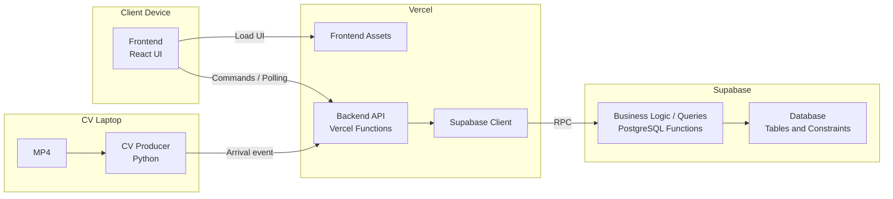

# Prototype Design

> Current implementation stage: manual stories US-01 through US-06 only; see [Prototype Backlog](Prototype%20Backlog.md) and [Session Handoffs](Session%20Handoffs.md). All CV work, including analyzer experiments, is deferred. CV interfaces below describe future seams, not tasks for this stage.


Status: proposed implementation design based on the agreed [scope](Prototype%20Scope%20Decision.md), [use cases](Use%20Cases.md), [domain model](Domain%20Model.md), and [state transitions](State%20Transition%20Consistency.md). Analysis drafts have not received a second stakeholder review. SSDs remain deferred. This document records design decisions; application code, SQL migrations, cloud provisioning, and deployment have not been performed.

## 1. Environment and boundaries

One store, one active demo run, a small predefined associate roster, and one receptionist-operated browser board. The browser and local Python process need internet access to the Vercel API; Vercel accesses Supabase. Python processes a prerecorded entrance MP4 locally and displays annotated video beside the browser. Working default: keep entrance crops transient on the CV laptop; do not store/display photos. An attribute analyzer implementation/provider has not been selected; external image transfer requires an explicit interface/provider decision and is not implied here.

Included: idle availability, manual/CV arrivals, appearance/demographic attributes and correction, manual exit registration, FIFO reservation, acceptance, visit purchase result, metrics, activity and reset. No multi-tenancy, user-role system, POS, group detection, automatic departure detection, timeouts, manual reassignment, or historical shift administration. Availability is about assignment eligibility, not attendance tracking.

## 2. Stack and deployment decisions

| Layer | Decision | Purpose |
|---|---|---|
| Browser | React.js + TypeScript built directly from requirements by Claude | One responsive operational board |
| Backend | Separate Vercel Functions alongside the React frontend | Validate commands, check demo access, call database functions |
| Persistence | Supabase PostgreSQL | Domain records, consistency constraints, atomic command functions |
| Refresh | GET board snapshot every 2 seconds, plus immediate refresh after a successful action | Baseline follows the sprint's polling fallback; Realtime is optional future work, not required |
| Local CV | Python 3.12, OpenCV, Ultralytics person detector with ByteTrack | Inward line crossing to arrival command |
| CV model | Start with a small YOLOv8 model supported by the installed Ultralytics package | Avoid changing model families during the sprint; exact versions pinned after environment smoke test |
| HTTP transport | HTTPS JSON, local Python HTTP client | Same arrival contract for CV and manual simulation |

Node.js runtime, React build tooling selected for the actual project, Supabase client, and Python package versions must be chosen as a compatible set and locked when scaffolding. No exact version compatibility has been verified yet. Next.js is not required; inspect existing files before initializing the React app. No external design export is expected.

CV is started manually on the laptop. It processes the local MP4 and sends arrival events to the cloud API. Browser-controlled startup, a local HTTP control service, and cloud inference are outside the baseline.

## 3. Component decomposition

The React web application is hosted on Vercel and downloaded by the operator's browser on a laptop or tablet. Its JavaScript runs in that browser. Only the Python CV process and input video require the local CV laptop; the browser may be on a different device.



Blocks show deployment locations; nodes show responsibilities. React runs in the browser and is hosted on Vercel. Backend logic spans Vercel API and PostgreSQL functions. All client/API connections use HTTPS in deployment; local development may use HTTP on localhost.

| Logical layer | Component | Execution / hosting |
|---|---|---|
| Presentation / Frontend | React UP Board | Executes in the browser; assets hosted on Vercel |
| Application / Backend API | Vercel Functions and Supabase gateway | Vercel |
| Business Logic / Backend | PostgreSQL command functions and FIFO dispatcher | Supabase PostgreSQL |
| Read Queries / Backend | Board snapshot function | Supabase PostgreSQL |
| Data Storage | Domain and technical tables with integrity constraints | Supabase PostgreSQL |
| External Event Producer | Python CV process | Local CV laptop |

| Component | Responsibility | Does not own |
|---|---|---|
| UP Board | Render queue, visits, turn actions, metrics and activity; retain request identity during retries | Authoritative business state or queue rotation |
| API Functions | Validate shape and access token, map domain results to HTTP | Multi-step database mutations in JavaScript |
| Supabase gateway | Thin typed RPC adapter | Duplicate business rules |
| PostgreSQL command functions | Validate current run, enforce transition rules, mutate linked objects and append activity atomically | Video inference or UI rendering |
| Dispatcher helper | Select oldest registered Waiting visit with no departed_at and first Available participant until capacity is exhausted | A background worker or timeout mechanism |
| Board snapshot function | Return one consistent current-run projection with derived metrics | Independent stored metric truth |
| CV process | Detect inward crossings, capture person crop, analyze attributes, send arrival/enrichment with retries | Assignment decisions or database credentials |

## 4. Interfaces

All commands use `sessionId`; all JSON times use ISO 8601 UTC. IDs are UUID strings. All routes require the applicable shared demo token in Authorization: Bearer <token>. Stage 1 uses only the operator token; exact manual request/replay/error rules are specified in [Backend Requirements](Backend%20Requirements.md). Dates are localized only in the UI.

| Interface | Request | Response / behavior | Use cases |
|---|---|---|---|
| GET /api/board | No body | Current session ID, startedAt, roster states and queue, visits/assignments, metrics, recent activity, server time | UC-02, UC-07/08/09 |
| GET /api/session | No body | Only current sessionId and startedAt; context for starting local CV | Supports UC-03 |
| POST /api/arrivals | sessionId, eventId, source, optional detectedAt, attributes | visitId, duplicate flag, resulting visit status; dispatch in the same transaction | UC-03/04 |
| POST /api/availability | sessionId, participantId, commandId, state (Available or OffFloor) | Applied/replayed result; dispatch on return to Available | UC-01/04 |
| POST /api/assignments/{id}/accept | sessionId | Current assignment identity and phase; repeated acceptance has no additional effect | UC-05 |
| POST /api/assignments/{id}/outcome | sessionId, outcome (Sale or NoSale) | Save Visit outcome, complete accepted turn; same replay succeeds; dispatch | UC-06/04 |
| PATCH /api/visits/{id}/attributes | sessionId, source (Manual/CV), attributes, enrichmentStatus | Current profile; CV cannot overwrite manual edit | UC-11 |
| POST /api/visits/{id}/departure | sessionId, optional outcome | Registered exit; require outcome if missing; close unfinished turn and dispatch | UC-12/04 |
| POST /api/demo/reset | sessionId | New sessionId and startedAt; clear old operational records and reseed participants atomically | UC-10 |

Example arrival body:

```json
{
  "sessionId": "<current-run-uuid>",
  "eventId": "<uuid-created-once-per-crossing>",
  "source": "CV",
  "detectedAt": "2026-10-27T18:02:11Z",
  "attributes": {"upperDescription": "", "lowerDescription": "", "accessoryDescription": null, "ageGroup": "Unknown", "gender": "Unknown"}
}
```

Visit.arrived_at is server entry registration time, allocated with arrival_order under the command lock. Optional detectedAt records the CV observation time separately. FIFO follows server registration, not local clocks. Reusing eventId with a different original payload is a conflict; identical arrival retries return the same visit even if its profile was enriched later. Persist the immutable original request in a current-run command receipt (including CV detection time/initial attributes) for replay comparison; exclude secrets/images. Manual form generates eventId once per submission and retains it during retry.

### Public DTOs and state values

Machine values are shared by API and database; UI labels may contain spaces/hyphens. Assignment phase is derived from timestamps, not stored separately.

| Concept | Machine value | Display / analysis label |
|---|---|---|
| AssociateSession state | Available | Available |
| AssociateSession state | OffFloor | Off Floor |
| AssociateSession state | PendingAcceptance | Pending Acceptance |
| AssociateSession state | OnUP | On UP |
| Assignment phase | PendingAcceptance | Pending Acceptance |
| Assignment phase | Accepted | Accepted |
| Assignment phase | Completed | Completed |
| Visit purchase outcome | Sale | Sale |
| Visit purchase outcome | NoSale | No-Sale |

Age values: Under20 (<20), From20To39 (20-39), From40To59 (40-59), Age60Plus (60+), Unknown. Gender values: Female, Male, Unknown; CV estimates are not verified gender identity. attributesSource is Manual/CV/Unknown; enrichmentStatus Pending/Complete/Failed/NotRequested. completionReason is OutcomeRecorded or Departure. Presence is Inside/Left derived from departedAt. Visit status uses Waiting, Assigned, Accepted, Completed without translation. Source uses CV or Manual. All DTO properties are present; optional milestone/context values are explicitly null. IDs are opaque to clients; queuePosition and waitingPosition are 1-based projected ranks, not database sequence tokens.

| DTO | Fields |
|---|---|
| SessionContext | sessionId, startedAt |
| AssociateView | participantId, associateId, displayName, state, queuePosition (null unless Available), currentAssignmentId (null if idle), assignedTurns, acceptedTurns |
| VisitView | visitId, arrivedAt, detectedAt (nullable), departedAt (nullable), source, status, attributes: VisitorAttributes, attributesSource, enrichmentStatus, outcome (nullable), outcomeRecordedAt (nullable), waitingPosition (null unless Waiting and inside), assignmentId (nullable) |
| VisitorAttributes | upperDescription, lowerDescription, accessoryDescription (nullable), ageGroup, gender |
| AssignmentView | assignmentId, visitId, participantId, phase, assignedAt, acceptedAt (nullable), completedAt (nullable), completionReason (nullable) |
| MetricsView | visitors, assignedTurns, acceptedTurns, closedSales, conversionRate (numeric percentage, not formatted text) |
| ActivityView | activityId, occurredAt, kind, description, visitId (nullable), participantId (nullable), assignmentId (nullable) |
| BoardSnapshot | session: SessionContext; associates: AssociateView[]; visits: VisitView[]; assignments: AssignmentView[]; metrics: MetricsView; activity: ActivityView[]; serverTime |
| ArrivalResult | sessionId, visitId, duplicate, status (current Visit status) |
| AvailabilityResult | sessionId, participantId, replayed |
| AcceptanceResult | sessionId, assignmentId, phase (current derived phase), replayed |
| OutcomeResult | sessionId, visitId, assignmentId, outcome, replayed |
| AttributesResult | sessionId, visitId, attributes, attributesSource, enrichmentStatus, ignored (CV blocked by manual override) |
| DepartureResult | sessionId, visitId, departedAt, outcome, replayed |
| ResetResult | sessionId (new run), startedAt |
| ErrorResponse | code (stable machine code), message (short public explanation) |

GET /api/session returns SessionContext; GET /api/board returns BoardSnapshot. POST endpoints return their corresponding Result. A command result acknowledges its operation; it is not a full board snapshot. Refresh the board after a successful browser action. An availability replay returns the saved acknowledgement, never reapplies the old state; the current state comes from the snapshot. Duplicate acceptance can return Completed if the assignment has since completed, without reopening it.

Associate entries have stable initial roster order; queuePosition determines the eligible rotation. Visits/assignments are returned in server registration order of their visits; activity is newest-first by server activity order. The UI may filter these arrays for waiting, pending, active, and completed views. Times remain ISO 8601 UTC. Neither arrivalOrder nor queue_order is exposed.

Queue order is explicit in the roster projection. Activity returns the most recent 100 entries in stable activity order; the database retains all current-run entries. Counts cover the whole run, not only the visible activity window. GET responses use Cache-Control: no-store. The snapshot is assembled in one SQL statement to avoid mixing states from different commits.

HTTP results: 200 success/replay, 201 new arrival, 400 invalid input, 401 missing/invalid demo token, 404 unknown current-run target, 409 stale session/invalid transition/conflicting replay, 503 temporary database unavailability, and 500 sanitized unexpected failure (not every failure is retryable). Return a stable error code and short message. Do not expose SQL details or secrets.

### Interface boundaries and DTOs

Use the explicit interfaces in [Design Class Diagram](Design%20Class%20Diagram.md): BoardService for the UI, WorkflowStore for API persistence, EntranceDetector for the whole CV pipeline, and ArrivalSink for delivery. Provide one adapter per interface now, wired explicitly; no framework or extra service is needed. Backend handlers call named WorkflowStore operations, not a generic RPC-by-name API. Gateway internals translate these operations to SQL function names.

HTTP responses are explicit DTOs, not raw table rows. Expose only board/action fields needed by the client; hide control rows, receipts, credentials, locking/order sequence internals, and SQL errors. Public queue order is a projected relative rank, not the raw queue token. CV reads only the minimal session context, so it is independent of board shape.

YoloEntranceDetector handles detection, tracking, and inward crossings; CvRunner adds current session/event identity; HttpArrivalPublisher owns HTTP and retries. Future CV implementations replace EntranceDetector without changing arrival contracts. Keep a bounded in-memory delivery buffer; pause prerecorded playback on overflow. No message bus, durable queue, or additional cloud CV service is required in this sprint.

## 5. Transaction and concurrency design

Agreed architecture decision: React and local CV call the Vercel HTTP API. The API validates access and input, calls PostgreSQL functions through Supabase RPC, and maps results to HTTP. Database functions implement the atomic data operations and FIFO dispatch. These are PostgreSQL functions, not Supabase Edge Functions. No additional Edge Function layer is required.

Keep each transition rule authoritative in one place: the database command function. Browser checks improve usability; API validation checks request shape/access; neither duplicates the queue algorithm. Database constraints independently protect keys, references, uniqueness, and valid values. Future external integrations or application orchestration belong in the backend rather than inside a database transaction.

Store table definitions, constraints, functions, grants, and seed setup in versioned SQL migrations under `supabase/migrations/` when implementation begins. Dashboard-only edits are not the source of truth. Verify each command's atomicity, duplicate handling, and concurrent reservation behavior with database integration checks. Existing arrival payload and visit DTOs are extended for attributes; attribute-update and departure endpoints are added by the visitor-scope revision.


Use one seeded `demo_control` row as a stable serialization point. Every mutating RPC first locks that same row with SELECT FOR UPDATE, then checks the supplied session ID against its current_session_id. The row survives reset. This deliberately serializes writes for a small single-store PoC and avoids complex per-queue locking.

A command performs all linked state changes, milestone timestamps, activity writes, and dispatch inside one database function/transaction. An error rolls the transaction back. No route handler coordinates separate writes to simulate a transaction.

- Arrival: validate/deduplicate immutable request, record entry at server time and initial attributes, create Waiting visit, append activity, dispatch.
- Availability: deduplicate commandId, reject busy participant, update eligibility/order if changed, append activity only for an actual change, dispatch if Available.
- Accept: validate current assignment, handle replay, set accepted_at, Visit Accepted, participant OnUP, append activity.
- Outcome: require acceptance; handle replay; set Visit.outcome/outcome_recorded_at and status Completed; set Assignment.completed_at/completion_reason OutcomeRecorded; release participant once, log and dispatch. Do not set departure time.
- Attributes: update profile fields only; manual override prevents late CV overwrite; record only actual changes. Unknown values remain valid on failed analysis.
- Departure: preserve existing Visit outcome or require explicit selection; set server departed_at once and service status Completed. Complete only an unfinished assignment with reason Departure (acceptance may be absent), release its participant once and dispatch. No assignment means no fabricated turn.
- Reset: validate old session under the stable lock, remove old-run data, create new run with started_at, seed initial Available roster, update control row, commit. Calls queued with the old session then fail validation.

Dispatcher uses server sequence values for visit arrival order. Under the same control lock, a queue append takes one plus the current maximum eligible queue_order (or 1 if none), so seeded and returned participants retain FIFO priority without a separate queue sequence. It selects oldest registered Waiting visit with no departed_at and lowest queue_order Available participant. Each successful reservation creates Assignment, changes Visit to Assigned and participant to PendingAcceptance, clears their queue_order, and writes activity. It loops until no waiting visit or eligible participant remains. Completed assignments stay unchanged when a participant receives a new turn.

Counters are calculated from records rather than incremented in separate tables. `up_count` is derived per participant. State changes and activity are committed together; UI refresh occurs after success.

## 6. Retry, reset, and connectivity behavior

- CvRunner creates eventId once per entry and queues the immutable payload in memory until acknowledged. Retry timeouts/network errors/503 with bounded backoff while the run remains current. A new process run does not promise durable delivery of unsent events; in-memory buffering is sufficient for the demo.
- Before playback, CV obtains sessionId from GET /api/session. On stale-session response it stops sending and requires a fresh run start; never relabel an old queued arrival into the new session.
- Availability uses commandId plus a stored receipt so a delayed retry cannot undo a later availability change. Same commandId with different content returns conflict. Acceptance/outcome use their assignment and milestone state as natural idempotency boundaries.
- Browser polls sequentially: one read in flight; discard an old snapshot if a newer refresh or local command has started. After a command, refresh from the server instead of rotating optimistically. Show connection state and retain last known data during failures.
- While a mutation is in flight disable its action. After an uncertain timeout, refresh before retry; retain the original arrival eventId/availability commandId. Never generate a replacement request identity for the same intent.
- Reset requires CV pause before the button is used. Disable browser commands until reset completes, discard old snapshots, and load the new run. If reset times out, fetch the board: a changed sessionId indicates completion; otherwise retry using the old sessionId. A delayed old reset cannot erase a newer run because validation occurs under the stable lock.

## 7. Demo access and configuration

No account/login/role-management workflow is introduced. The API uses a shared operator token entered once in the board and held in memory, and a separate CV token configured in the local process. This is a limited demo access mechanism, not user authentication. Operator access permits board and all commands; CV access permits GET /api/session, CV arrivals, and CV attribute enrichment only; GET /api/board remains operator-only. Enforce source values against token purpose. Use same-origin browser API calls.

Server-only configuration: SUPABASE_URL, SUPABASE_SERVICE_ROLE_KEY, DEMO_OPERATOR_TOKEN, CV_INGEST_TOKEN. Python delivery needs API_BASE_URL and CV_INGEST_TOKEN; attribute model configuration is separate and remains to be chosen. Never embed server secrets in client-exposed build variables, frontend source code, or event logs. Enable RLS and deny direct anonymous/authenticated table access; grant RPC execution only to the backend service role, revoke default PUBLIC/anon/authenticated execution, including helpers. The browser never writes directly to Supabase. Prefer invoker-rights database functions called by the trusted backend role.

## 8. Verification before demo

| Scenario | Required observation |
|---|---|
| Main path | CV arrival -> pending assignment -> Accept -> Sale -> completed visit, updated metrics, associate released |
| Rapid distinct arrivals | Distinct visits, FIFO assignment, no associate with two unfinished turns |
| All Off Floor / all busy | Visits stay Waiting; returning/completing capacity serves oldest registered Waiting visit with no departed_at |
| Duplicate arrival transport | Same eventId returns same visit, no extra activity or assignment |
| Duplicate/stale actions | Acceptance/outcome/availability retries do not repeat effects; conflicting outcome rejected |
| CV line recrossing | Local crossing protection prevents unintended duplicate arrivals; distinct real entries remain possible |
| Polling/network recovery | Board recovers from authoritative snapshot without duplicate mutations |
| Reset and in-flight requests | Fresh roster/order/counters; old commands rejected; old CV payloads not replayed into new run |

Implementation order: schema and atomic RPCs -> seeded board snapshot -> manual arrival form/main turn/exit path -> availability/reset -> deploy -> smoke-test attribute analyzer -> standalone CV -> connect arrival/enrichment -> targeted verification and backup demo recording. Visitor profile analysis and manual departure are explicit user-authorized additions to the earlier sprint baseline.

## 9. Technical references

Database RPC and execution permissions follow [Supabase database functions](https://supabase.com/docs/guides/database/functions). Browser database isolation uses [Supabase RLS](https://supabase.com/docs/guides/database/postgres/row-level-security). The stable row-lock design relies on [PostgreSQL explicit locking](https://www.postgresql.org/docs/17/explicit-locking.html). These sources support platform mechanisms; the architecture and contracts above are project design decisions.

Related artifacts: [Database Design](Database%20Design.md), [Design Class Diagram](Design%20Class%20Diagram.md).

## 10. Visitor enrichment and exit revision

Purchase outcome is stored only on Visit. Closed sales = count current-run Visit.outcome Sale, including visits without assignment. Normal UC-06 records result and completes accepted service; UC-12 records physical exit and obtains a missing result, handling unassigned and pending visitors without inventing acceptance. A second exit never releases an associate who has moved to another turn. UI separates service state, purchase result and presence; show registered entry/exit times and profile fields.

Working defaults (not separately confirmed): registration/assignment proceeds immediately, profile enrichment is asynchronous, and images are transient with no saved thumbnail. Unknown values are honest incomplete observations. Manual arrival fills the same schema; manual profile correction blocks subsequent CV overwrite. These defaults must not be represented as separately approved image-retention/provider requirements.

Add VisitorAttributeAnalyzer.analyze(personCrop) -> VisitorAttributes at the CV boundary. Detection emits a transient crop; CvRunner schedules local analysis and submits UC-11 with the original visitId/event association. On detector replay/HTTP timeout use the existing eventId; when the visitId is known send enrichment against that visit, never a new arrival. No model/provider is selected or claimed functional. Verify age/gender/description extraction on the demo footage early; implementation choice is still open. No cloud image upload or storage is added by this design update.

Additional verification: manual form roundtrip; all four age bins/Unknown; delayed/failed analysis; late CV after manual edit; reset with queued enrichment; exit while Waiting/Pending/Accepted/Completed; duplicate exit; sale without assignment; completed visitor exits after associate receives another turn; concurrent outcome/exit preserves existing result.

## 11. Stage 1 contract review

See Backend Requirements section 6 for complete manual request bodies, payload normalization, replay precedence, error codes, activity behavior and setup ownership. SessionContext uses sessionId consistently. Frontend is built by Claude from requirements, not from a design export. Full-scope CV request examples above are future reference, not currently accepted Stage 1 input. Stage 1 rejects CV source and non-null detectedAt until that workstream is implemented. Purchase/profile/exit rules remain shared with the UI contract.
