# Assignment State Machine Diagram

Aligned with [Domain Model](Domain%20Model.md), [Use Cases](Use%20Cases.md) and [State Transition Consistency](State%20Transition%20Consistency.md). Purchase outcome is on Visit, not Assignment. Phase is derived from timestamps, checking completedAt first.

```mermaid
stateDiagram-v2
    state "Pending Acceptance" as PendingAcceptance
    [*] --> PendingAcceptance: UC-04 / set assignedAt; retain queue position
    PendingAcceptance --> Accepted: UC-05 [visitor inside] / set acceptedAt; move participant to bottom once; offer next
    Accepted --> Completed: UC-06 / set completedAt and reason OutcomeRecorded
    PendingAcceptance --> Completed: UC-12 / set completedAt and reason Departure
    Accepted --> Completed: UC-12 / set completedAt and reason Departure
    Completed --> [*]
```

| Phase | Invariant |
|---|---|
| Pending Acceptance | assignedAt exists; acceptedAt/completedAt/completionReason absent |
| Accepted | acceptedAt exists; completedAt/completionReason absent |
| Completed | completedAt and completionReason present; acceptance may be absent only for reason Departure |

OutcomeRecorded requires prior acceptance; Departure is a distinct early-completion path, not an invented acceptance or reassignment. Acceptance advances rotation once. Completion does not change availability/order. Repeated exit after this assignment was completed must not move the participant or affect any of their other assignments. Normal outcome and departure races serialize: preserve the first purchase result, apply missing exit separately, reject conflicting outcome. No timeout, decline, or manual reassignment. Reset removes records without fabricating milestones.
