# AssociateSession State Machine Diagram

Availability is independent of accepted assignments. See [Rotation Revision](Assignment%20Rotation%20Revision.md).

```mermaid
stateDiagram-v2
    state "Off Floor" as OffFloor
    [*] --> Available: Initialize / seed initial order
    Available --> OffFloor: UC-01 [not owner of pending offer] / leave queue
    OffFloor --> Available: UC-01 / append to bottom; attempt offer
    Available --> Available: UC-05 accept offer / move to bottom once; attempt next offer
```

Offer creation does not change availability/order. Only one unresolved pending offer exists across the session; later visitors wait for its confirmation. Multiple accepted unfinished assignments per participant are valid. Normal outcome and all departures leave availability/order unchanged. Pending-offer departure clears the gate and attempts the next visit without consuming the participant's turn. Reset creates new participation records. No OnUP availability state or exclusive-service capacity limit exists.
