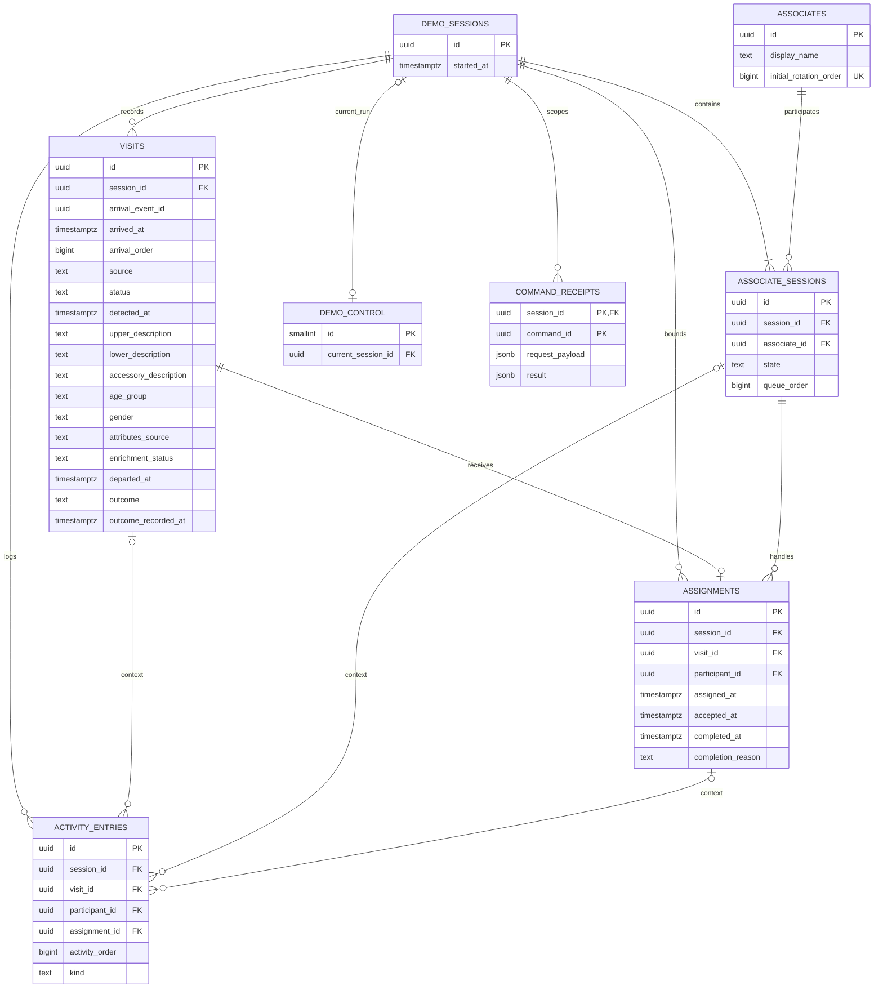

# Database Design - Supabase PostgreSQL

> Breaking business-rule revision: [Advance on Acceptance](Assignment%20Rotation%20Revision.md) is authoritative for rotation, availability, pending-offer gating and DTOs. Earlier exclusive-until-outcome behavior is withdrawn. Apply this change to both independent implementation repositories.

Proposed physical mapping of the [domain model](Domain%20Model.md). Command behavior and API contracts are in [Prototype Design](Prototype%20Design.md). SQL migrations are not yet implemented.

## 1. Tables and keys

All timestamps are timestamptz, all IDs UUID unless otherwise noted. PK columns are non-null. Fields are non-null unless marked nullable. State/outcome values are constrained text for this PoC. Foreign keys below are explicit implementation associations.

| Table | Columns / keys | Constraints and notes |
|---|---|---|
| demo_sessions | id PK; started_at timestamptz default server time | One current run referenced by demo_control. No ended_at/history: reset deletes the old run. Adding retained closed sessions would change scope. |
| associates | id PK; display_name text; initial_rotation_order bigint | Initial order UNIQUE; predefined stable roster survives reset |
| associate_sessions | id PK; session_id FK -> demo_sessions.id; associate_id FK -> associates.id; state text; queue_order bigint nullable | UNIQUE(session_id, associate_id); UNIQUE(session_id, id); state in Available/OffFloor; queue_order present iff Available; UNIQUE(session_id, queue_order) |
| visits | id PK; session_id FK -> demo_sessions.id; arrival_event_id UUID; arrived_at timestamptz; arrival_order bigint server sequence; source text; status text; detected_at timestamptz nullable; upper_description text; lower_description text; accessory_description text nullable; age_group text; gender text; attributes_source text; enrichment_status text; departed_at timestamptz nullable; outcome text nullable; outcome_recorded_at timestamptz nullable | UNIQUE(session_id, arrival_event_id); UNIQUE(session_id, arrival_order); UNIQUE(session_id, id); source CV/Manual; status Waiting/Assigned/Accepted/Completed |
| assignments | id PK; session_id FK -> demo_sessions.id; visit_id UUID; participant_id UUID; assigned_at timestamptz; accepted_at nullable; completed_at nullable; completion_reason text nullable | Composite FK(session_id, visit_id) -> visits(session_id, id); composite FK(session_id, participant_id) -> associate_sessions(session_id, id); UNIQUE(visit_id); partial UNIQUE(session_id) WHERE accepted_at IS NULL AND completed_at IS NULL |
| activity_entries | id PK; session_id FK -> demo_sessions.id; occurred_at timestamptz; activity_order bigint server sequence; kind text; description text; visit_id UUID nullable; participant_id UUID nullable; assignment_id UUID nullable | Each optional context uses composite FK(session_id, context_id) to its table's (session_id, id); assignments also exposes UNIQUE(session_id, id). Kind includes VisitorAttributesUpdated and VisitorDeparted in addition to the original five kinds. UNIQUE(session_id, activity_order) |
| demo_control | id smallint PK fixed to 1; current_session_id FK -> demo_sessions.id | Technical singleton, seeded at setup; stable row locked by all command RPCs. current_session_id nullable only during setup/reset within a transaction; committed operation requires exactly one current session. |
| command_receipts | session_id FK -> demo_sessions.id; command_id UUID; command_kind text; request_payload jsonb; result jsonb | Composite PK(session_id, command_id). Technical retry bookkeeping for availability commands and immutable arrival payloads; compare normalized payload before replay. Removed on reset. |

The redundant assignments.session_id is deliberate in the physical model: composite FKs enforce that visit and participant belong to the same session. It was omitted as a direct association in the conceptual diagram. The two technical tables are not additional business entities.

started_at addresses the session start-time requirement discussed during analysis. Who participated is represented by associate_sessions, not an array on demo_sessions. joined_at/left_at, ended_at and session history remain absent because check-in/check-out and close-session workflows are deferred.

## 2. ER diagram

Mermaid lists representative columns; the table above is authoritative for all columns and composite constraints.

The conceptual one-or-more seeded participants constraint is enforced by setup/reset, not a simple FK. DEMO_CONTROL may reference zero sessions only transiently inside setup/reset, never as a successful board response.

## 3. Integrity constraints

Visit CHECK rules:

- outcome is NULL, Sale, or NoSale; outcome_recorded_at is present iff outcome exists.
- status Completed iff outcome is present, for the currently defined commands.
- departed_at, when present, is >= arrived_at; departure implies status Completed and outcome present.
- age_group is Under20/From20To39/From40To59/Age60Plus/Unknown; gender is Female/Male/Unknown.
- attributes_source is Manual/CV/Unknown; enrichment_status is Pending/Complete/Failed/NotRequested. Empty upper/lower text denotes not yet known; accessory may be NULL.
- CV detected_at is optional and independent of server arrival registration time; no ordering constraint ties local clock to server clock.

Assignment CHECK rules:

- completion_reason is NULL, OutcomeRecorded, or Departure, present iff completed_at exists.
- OutcomeRecorded requires accepted_at; Departure permits absent accepted_at.
- assigned_at <= accepted_at <= completed_at when present; completed_at >= assigned_at.
- Purchase outcome is not stored on assignments. Cross-record correspondence to Visit is enforced in command functions.

Indexes: Waiting visits by (session_id, arrival_order), Available participants by (session_id, queue_order), activity by (session_id, activity_order DESC), and assignments by session_id. Partial uniqueness protects one unresolved pending offer per demo session; accepted unfinished assignments are not capacity-limited. Existing unique keys and arrival receipts cover event deduplication and one assignment per visit.

Cross-table state correspondence cannot be enforced by ordinary CHECK constraints. It is maintained by the command functions under the stable control-row lock; direct client writes are denied. Verify these invariants with database integration scenarios before the demo.

Record server milestone times after acquiring the control lock, using the actual operation time (not a transaction-start timestamp captured before waiting for the lock).

Sequence values are order tokens, not human turn counts; gaps after transaction rollback are acceptable. Derive assigned/accepted counts from assignments and sale counts from visits. No counters table or separate outcome table; Visit owns the result.

## 4. Reset deletion and stale requests

Reset locks demo_control, verifies expected current session, temporarily clears its reference, deletes old data in dependency order (receipts, activity, assignments, visits, associate_sessions, demo_sessions), creates the new session/participants, and updates current_session_id before commit. Use restrictive FKs and explicit deletion order to avoid ambiguous cascade paths. Any failure rolls back the complete reset. Other mutating commands must obtain the same control lock first and then validate the run.

Snapshots read the control row and joined records in one SQL statement: they see either the old committed run or the new committed run, not the reset's intermediate state. CV must be paused and restarted with the new session identity. Shared technical sequences need not restart; initial queue order is reseeded from associates.initial_rotation_order. Queue append values must be allocated above the current maximum, including seeded values.

## 5. Read projection and traceability

Board query joins current participants to associates and assignments; visits determine visitor lifecycle. Metrics use current-session records only. Activity is ordered by server activity_order. No account IDs, reusable customer identities, images or video are stored under the provisional no-image-retention default. Visit stores appearance and demographic observations; they are not verified identity data.

| Use cases | Tables / calculation |
|---|---|
| UC-01/02 | associates + associate_sessions; command_receipts for retried availability |
| UC-03/04 | visits + associate_sessions + assignments + activity_entries |
| UC-05/06 | assignments + visits + associate_sessions + activity_entries |
| UC-07 | visits and assignments |
| UC-08 | visits count and Sale outcomes; assignment counts by milestones |
| UC-09 | activity_entries and optional contexts |
| UC-10 | demo_control + all current-run tables; preserve associates |
| UC-11 | visits description/demographic/provenance fields + activity |
| UC-12 | visits departure/outcome + optional assignment completion; no participant rotation + activity |

## 6. Implementation source of truth

Agreed execution boundary: Vercel API -> Supabase RPC -> PostgreSQL command transaction. This does not introduce Supabase Edge Functions. Keep SQL definitions and permissions in versioned `supabase/migrations/` files, alongside application code; do not rely on unrecorded Dashboard edits. Schema, functions, grants, and initial roster setup must be reproducible. Command functions own transition/queue rules; constraints protect data integrity. Migration files and integration checks will be created during implementation, not as part of this design update.

## 7. Public naming and arrival order

Machine enum values and DTO projections are specified in Prototype Design. Display labels such as Off Floor, On UP, Pending Acceptance, and No-Sale map to OffFloor, OnUP, PendingAcceptance, and NoSale. Assignment phase is derived as PendingAcceptance, Accepted, or Completed. arrival_order is allocated during server registration under the stable command lock, not from CV timestamps or HTTP request start time; late arrivals join the end without reordering assignments.

## 8. Attribute updates and departure transactions

recordDeparture uses the same control-row lock as other mutations. Preserve a stored purchase result; otherwise require explicit Sale/NoSale. Record server departed_at once and status Completed. If an assignment is unfinished, set completed_at/reason Departure, preserve accepted_at as-is, keep participant order/availability unchanged; dispatch only when closing the pending offer. If service was accepted/completed, do not move the participant, who may have multiple accepted assignments. No assignment is created for an unassigned visitor. Same exit retry preserves timestamp; conflicting result returns conflict.

updateVisitorAttributes validates run/source and fields, preserves manual profiles against late CV writes, and logs only actual changes. Manual updates are profile replacements; CV supplies one final result per visit or a Failed marker. Duplicate identical writes are no-ops; failed analysis does not erase useful values. Enrichment can finish after departure but is rejected after reset. These commands do not edit outcome or registration timestamps. Handler roles enforce Manual vs CV provenance.

Arrival receipts store immutable source/detectedAt/initial attributes keyed by the original eventId, with kind Arrival. This allows exact replay comparison after Visit attributes have been enriched or manually corrected. A single command ID namespace covers Arrival and Availability; conflicting kind/payload returns conflict. No image bytes or access tokens are stored in receipts.

Stage 1 command normalization, authentication, replay precedence and exact public error codes are in [Backend Requirements](Backend%20Requirements.md), section 6. A queue append uses current-session eligible MAX(queue_order)+1 (or 1 for an empty queue) under the stable lock, not an independently initialized sequence. The seed order is therefore respected without sequence synchronization.
