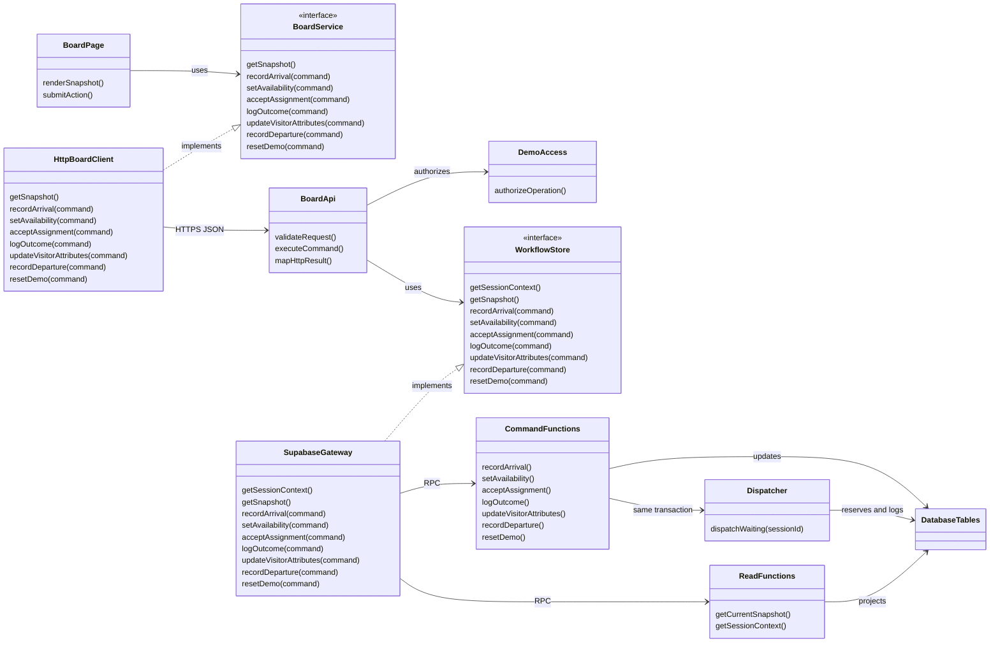
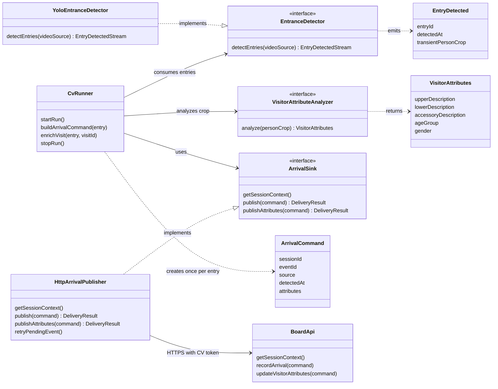

# Design Class Diagram

> Breaking business-rule revision: [Advance on Acceptance](Assignment%20Rotation%20Revision.md) is authoritative for rotation, availability, pending-offer gating and DTOs. Earlier exclusive-until-outcome behavior is withdrawn. Apply this change to both independent implementation repositories.

> Current implementation stage: manual stories US-01 through US-06 only; see [Prototype Backlog](Prototype%20Backlog.md) and [Session Handoffs](Session%20Handoffs.md). All CV work, including analyzer experiments, is deferred. CV interfaces below describe future seams, not tasks for this stage.

Implementation design for the two-day prototype, based on [Prototype Design](Prototype%20Design.md). Explicit interfaces appear only at boundaries that need substitution. They can be TypeScript types, Python Protocols, or small function-based adapters; they do not require dependency injection frameworks or separate services. Domain records and keys remain in [Database Design](Database%20Design.md).

## 1. Web application and persistence

BoardService is the frontend-facing contract; WorkflowStore is the backend-facing persistence contract. Their operations intentionally use the same domain vocabulary but are separate boundaries: HTTP error handling belongs to HttpBoardClient; SQL/RPC error mapping belongs to SupabaseGateway. A private generic RPC helper may be used inside the gateway; API handlers must not supply SQL function names.

BoardPage represents a small page composed of QueuePanel, VisitsPanel, MetricsPanel, and ActivityPanel. A board hook owns sequential polling, connection state, request identity, and stale-response rejection. These are simple local components/modules, not extra architecture layers.

BoardApi and CommandFunctions are groups of route handlers and SQL functions, not single monolithic classes. BoardApi in each diagram is a partial view of the same component: the web view summarizes request handling; the CV view shows only its consumed session, arrival and attribute-update endpoints. There is no separate CV backend. Dispatcher is a private helper callable only inside command transactions. ReadFunctions returns explicit DTOs; raw database rows, lock tokens, receipts, and SQL errors are not public contracts. BoardSnapshot contains session, associates, visits, assignments, metrics, activity, and serverTime as specified in Prototype Design.

## 2. Replaceable local CV pipeline

EntranceDetector abstracts the whole detection/tracking/inward-crossing pipeline, not only YOLO bounding boxes. Its contract emits one EntryDetected per intended inward crossing. Internal model, track IDs and line configuration stay inside the implementation. A transient person crop accompanies the entry for attribute analysis; it is not part of the cloud arrival payload. YoloEntranceDetector is the only production implementation in this sprint; a future implementation must honor the same semantics. No placeholder alternative class is implemented now.

CvRunner obtains session context, consumes entries, and builds one immutable ArrivalCommand per entry, followed by a separate attribute update when analysis completes. entryId is a detector-run-unique opaque identity, not a reusable track number; it maps to one generated eventId. Retries retain that exact eventId/payload. source is CV. registered entry time comes from the server; detectedAt is a separate local observation. HTTP credentials and retry behavior belong to HttpArrivalPublisher, not to the detector. DeliveryResult distinguishes acknowledged, retryable, stale session, and permanent rejection; stale session stops the run rather than moving old entries into a new run.

Use a small in-memory pending-event buffer. Detection and delivery must not block frame processing indefinitely; process bounded network attempts between frames or use one lightweight sender thread if needed. Cap the buffer; if full, pause prerecorded playback and report the problem rather than silently dropping entries. Reset requires pause, discard old-run pending work, fetch fresh context, and start fresh playback. No disk-backed queue or distributed worker is required.

## 3. Minimal implementation scope and evolution

| Boundary | Implement now | Future extension |
|---|---|---|
| UI - HTTP | BoardService + HttpBoardClient; small board hook/panels | React UI changes without modifying API clients |
| API - persistence | WorkflowStore + SupabaseGateway; explicit operations | Another adapter if persistence changes; SQL business rules still require porting |
| CV inference | EntranceDetector + YoloEntranceDetector | Replace the complete pipeline behind the same entry-event contract |
| CV attributes | VisitorAttributeAnalyzer contract; select and smoke-test implementation early | Replace attribute analysis independently of detector |
| CV delivery | ArrivalSink + HttpArrivalPublisher | Durable or broker-backed delivery only when required |

Construct adapters explicitly at startup/module entry points. No DI container, generic repository, service per class, or plugin discovery framework. One implementation per interface now; the interface documents the seam and allows small test doubles where useful.

Message bus is outside this PoC: one producer sends to one API with event identity, retries, and deduplication. No broker, event bus, or event-sourcing system is introduced. Reconsider durable messaging when prolonged outages, independent consumers, replay, or throughput justify its operational cost. A future asynchronous sink must preserve acknowledgement/delivery semantics rather than pretending enqueueing means a visit was already committed.

## 4. Design principles and accepted tradeoffs

Abstraction: callers use domain commands and DTOs. Decomposition: small UI, HTTP, persistence, and CV modules. Separation of concerns: UI renders, API validates/access-checks, SQL functions own transitions, detector recognizes entries, publisher delivers. Information hiding: SQL names/locking/credentials and CV internals stay behind adapters. Cohesion: each module has one focused responsibility. Coupling: external boundaries use contracts; SQL business logic remains intentionally coupled to PostgreSQL for the sprint's atomic operations.

Do not duplicate queue/state rules in UI or API. Database constraints independently enforce integrity. Existing transaction/reset rules remain authoritative. Interfaces are lightweight; visitor profiling and manual departure are explicit additions to the earlier product scope. Code and integration checks are not implemented yet.

## 5. Visitor profile and departure extension

BoardService/WorkflowStore include updateVisitorAttributes and recordDeparture; gateway delegates each to one atomic SQL operation. Assignment outcome is removed: Visit owns purchase outcome/time, description/demographic fields and entry/exit registration times. Assignment has completionReason, including Departure for a pending turn closed without acceptance. UI contains manual arrival/profile fields and a Mark Exit action that requests Sale/NoSale only when missing.

VisitorAttributeAnalyzer is a fifth small interface, separate from EntranceDetector and ArrivalSink. Its implementation is not yet selected; this is an unresolved technical dependency requiring an early sample-footage smoke test. Do not imply YOLO person detection alone supplies clothing descriptions or age/gender estimates. Working defaults are nonblocking enrichment and no saved image; see scope decision. Manual profile updates take precedence. No message broker is added.

Rotation revision: Dispatcher creates one offer and keeps queue position; accept command moves to bottom and dispatches. Outcome/departure never rotates participants. Use AssociateView.pendingAssignmentId and activeAssignmentIds/activeTurns instead of singular currentAssignmentId; see Assignment Rotation Revision. Two independent projects use API_BASE_URL and backend CORS.
