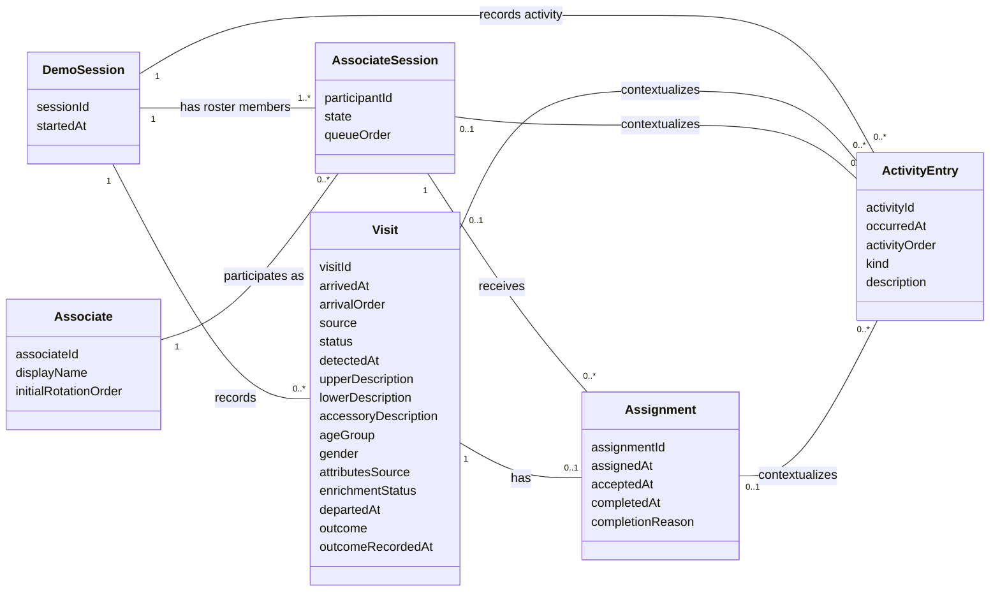

# Domain Model - 2-Day Prototype

> Breaking business-rule revision: [Advance on Acceptance](Assignment%20Rotation%20Revision.md) is authoritative for rotation, availability, pending-offer gating and DTOs. Earlier exclusive-until-outcome behavior is withdrawn. Apply this change to both independent implementation repositories.

Status: analysis draft for stakeholder validation. Based on [Use Cases](Use%20Cases.md) and [Prototype Scope Decision](Prototype%20Scope%20Decision.md). SSDs remain deferred. This is a conceptual model of information the system remembers, not a database schema or Design Class Diagram; methods, APIs, foreign keys, and persistence choices are not specified here.

## 1. Noun technique - candidate things

Extract nouns and noun phrases from the current use cases, consolidate synonyms, then decide whether each denotes a class, an attribute/value, derived information, an external role, or something outside sprint scope.

| Candidate noun / phrase | Source | Decision | Reason |
|---|---|---|---|
| Demo session, demo run | UC-03, UC-10 | Keep as DemoSession | Bounds operational data and distinguishes current activity from stale actions after reset |
| Associate, salesperson | UC-01, UC-04 | Keep as Associate | A predefined person in the roster retains identity and display name across resets |
| Associate in session, roster member | UC-01, UC-04, UC-10 | Keep as AssociateSession | Holds availability and rotation data for one associate in one demo session; it is seeded automatically, not created through check-in |
| Visitor, customer, visit, arrival | UC-03, UC-07 | Consolidate as Visit | The system remembers an anonymous visit, not an identifiable person or a reusable customer profile |
| Assignment, turn, UP | UC-04, UC-05, UC-06 | Consolidate as Assignment | One responsibility relationship has assignment, acceptance, and completion milestones; a separate Turn would duplicate it |
| Outcome, Sale, No-Sale | UC-06, UC-12 | Visit attribute | Purchase result exists even without assignment; no POS transaction entity |
| Activity, activity entry, operational event | UC-09 and UC-03 through UC-06 | Keep as ActivityEntry | Timestamped occurrences are needed for the visible activity log |
| Activity log | UC-09 | Collection/view of ActivityEntry | No additional lifecycle or information requiring another class |
| Rotation queue, FIFO order, Next UP | UC-02, UC-04 | Ordered view of Available AssociateSession records | Persist the ordering fact on session participation; derive the queue and first eligible member |
| Waiting queue | UC-03, UC-04 | Ordered view of Waiting Visit records | Server registration order determines oldest-first service; no independent queue entity needed |
| Availability, Available, Off Floor | UC-01 | AssociateSession state values | Independent of accepted unfinished assignments |
| Waiting, Assigned, Accepted, Completed | UC-03 through UC-07 | Visit state values | Describe the visit lifecycle |
| Arrival source, CV, manual form | UC-03 | Visit source value | Distinguishes CV and Manual; the button is a UI control, not stored business information |
| Timestamp, registered entry/exit, acceptance, completion | UC-03 through UC-06, UC-12 | Attributes | Visit stores registered entry/exit; Assignment stores service milestones |
| Upper/lower clothing, accessory, age group, gender | UC-03, UC-11 | Visit attributes | Optional accessory and Unknown values; observations are not identity profiles |
| Physical presence | UC-12 | Derived from departedAt | Inside until exit is registered; independent of service status |
| Assigned turns, accepted turns, up_count, closed sales, conversion | UC-08 | Derived values | Calculate from visits and assignment milestones; no independent Metric class required |
| Receptionist, Associate actor, manager | Actor/stakeholder descriptions | No additional role/account classes | Associate identity is retained above; authentication, user accounts, and operator audit identity are outside this PoC |
| Computer Vision System, camera, video, line crossing payload | UC-03 | External producer / technical input | Persist visit source, registration times and extracted attributes; tracking/video storage and transport contracts belong to interface design |
| Board, action card, notification, metric display | UC-02, UC-05, UC-08 | UI representations | They display stored domain information |
| Reset | UC-10 | Behavior | Clears operational information and restores initial roster/order; not a stored class |
| StoreShift, AssociateShift, Open Floor, group, departure | Earlier drafts | Defer | Outside agreed sprint scope; AssociateSession is seeded demo participation, not a check-in/check-out shift workflow |

## 2. Refined things to store

Logical identifiers below express identity only; they do not prescribe database keys or types. Optional means absent until the corresponding lifecycle milestone. Derived states/counts may be computed or stored during implementation, but must have one consistent meaning.

| Domain class | Information to remember | Purpose / use cases |
|---|---|---|
| DemoSession | session identity, startedAt | Current demo-run boundary; UC-03 through UC-10. Reset establishes a fresh run identity without introducing historical shift management. |
| Associate | associate identity, display name, initial rotation order | Predefined roster and deterministic reset configuration; UC-01, UC-02, UC-10 |
| AssociateSession | participant identity, state, queue order (only meaningful while Available) | Session-specific participation, eligibility, and FIFO ordering; UC-01, UC-02, UC-04 through UC-06 |
| Visit | visitId, arrivedAt, arrivalOrder, optional detectedAt, source, status, upperDescription, lowerDescription, optional accessoryDescription, ageGroup, gender, attributesSource, enrichmentStatus, optional departedAt, optional outcome, optional outcomeRecordedAt | Anonymous visit, appearance/demographic observations, physical presence, purchase result; UC-03/04/06/07/08/11/12 |
| Assignment | assignmentId, assignedAt, optional acceptedAt, optional completedAt, optional completionReason | Reservation, acceptance and service completion; purchase outcome belongs to Visit |
| ActivityEntry | activity identity, occurredAt, activityOrder, kind, description | Ordered operational history; UC-09. Associate availability entries also retain previous/new state in their description. |

### Attribute values and derived information

- AssociateSession.state: Available or Off Floor. Pending Acceptance and Accepted are Assignment phases, not availability states.
- Visit.source: CV or Manual. Visit.status: Waiting, Assigned, Accepted, Completed.
- Visit.outcome: absent, Sale, or No-Sale; outcomeRecordedAt is present iff outcome exists. departedAt is independent of outcome time.
- Visit demographics: ageGroup Under20/From20To39/From40To59/Age60Plus/Unknown; gender Female/Male/Unknown. Unknown is permitted; automatic values are visual estimates.
- Visit.attributesSource: Manual/CV/Unknown. enrichmentStatus: Pending/Complete/Failed/NotRequested. Profile-level manual override blocks later CV writes.
- Assignment.completionReason: absent, OutcomeRecorded, or Departure; present iff completedAt exists. Departure may complete a pending assignment without acceptance.
- Assignment phase is derived in this order: completedAt means Completed; otherwise acceptedAt means Accepted; otherwise Pending Acceptance.
- ActivityEntry.kind: ArrivalRecorded, AssignmentCreated, AssignmentAccepted, TurnCompleted, AvailabilityChanged, VisitorAttributesUpdated, or VisitorDeparted. This is an operational activity record, not an event-sourcing architecture or raw CV message store.
- Session visits = count of its Visit records; assigned turns = count of its Assignment records; accepted turns = count of assignments with acceptedAt; closed sales = count of Visit records with outcome Sale (with or without assignment).
- An associate's up_count is the count of assignments linked to their AssociateSession. It is not a rotation priority.
- Conversion = Sale visits / all recorded visits * 100, or 0% for no visits. A waiting or unfinished visit remains in the denominator.
- arrivalOrder is server registration order, independent of CV timestamps and transport delays; delayed arrivals do not reorder existing assignments. Queue order and arrivalOrder represent stable relative order, including equal timestamps. Numeric representation and concurrency mechanics are design decisions.

## 3. Domain Class Diagram

### Association interpretation

| Association | Meaning |
|---|---|
| DemoSession - AssociateSession | Each participant belongs to exactly one session; a seeded session has one or more roster members. All may be Off Floor, so the eligible queue may still be empty. |
| Associate - AssociateSession | Each participant represents exactly one predefined associate. At most one participation per associate per session. The roster identity can exist without current participation during reset/setup. |
| DemoSession - Visit | Each visit belongs to exactly one session; a session may have no visits. |
| AssociateSession - Assignment | Each assignment links exactly one session participant. A participant may have multiple accepted unfinished assignments. Only one unresolved pending offer exists across the session. |
| Visit - Assignment | Each assignment serves exactly one visit. A Waiting visit has no assignment; Assigned/Accepted have exactly one. Completed may have no assignment when departure was recorded while Waiting. Reassignment is deferred, so multiplicity is at most one. |
| DemoSession - ActivityEntry | Each activity belongs to exactly one session. Reset clears that run's activity rather than preserving historical shifts. |
| Optional activity context associations | Each entry may refer to at most one Visit, one AssociateSession, and one Assignment; each domain object can have many entries. Arrival references a visit; availability references a participant; assignment/acceptance/completion reference the assignment and its visit/participant. All contexts must belong to the entry's session. |

Assignment belongs to a session through its Visit and AssociateSession; both paths must identify the same session. A redundant direct session association is omitted. Ordinary associations express relationships without prescribing storage ownership or deletion mechanics.

## 4. Domain constraints and use-case validation

| Rule | Consequence for the model | Use cases |
|---|---|---|
| One run is current | Only current-run objects can be changed; reset invalidates old references and reseeds participation | UC-10 and stale-action alternatives in UC-05/06 |
| One unresolved offer per session | At most one Assignment with neither acceptedAt nor completedAt; multiple accepted unfinished assignments per participant allowed | UC-04, UC-05 |
| One assignment per visit | Waiting has none; Assigned has pending; Accepted has active; Completed may have zero or one completed assignment | UC-03 through UC-07, UC-12 |
| FIFO eligibility | Available participants remain in order during offer; acceptance moves to bottom once; outcome/exit do not rotate | UC-01, UC-02, UC-04, UC-05 |
| Oldest visit first | Select Waiting visits by stable arrival order | UC-03, UC-04 |
| Normal outcome completion requires acceptance | OutcomeRecorded requires acceptedAt; Departure may complete pending without it; timestamps ordered when present | UC-05, UC-06, UC-12 |
| One outcome, once | Repeated acceptance/completion cannot create extra milestones, activity entries, assignments, sales, or queue moves | UC-05, UC-06 |
| No independent metric truth | Counts and conversion agree with visits and assignment facts | UC-08 |
| Outcome does not mean departure | Visit.departedAt is registered separately; exit requires a visit purchase result, without inventing an assignment | UC-06, UC-07, UC-12 |
| Reset preserves roster configuration | Remove run activity, visits, assignments, and participant state; establish fresh run and Available participants in initial order; CV paused | UC-10 |

All twelve use cases have the required remembered information: availability/queue use AssociateSession; arrivals use Visit; turns use Assignment; visibility derives from these records and ActivityEntry; reset uses DemoSession and the predefined Associate roster. No additional CRUD workflow is introduced by retaining these concepts.

## 5. Validation status

Noun extraction and trimming are documented; the diagram is a proposed model, not a claim of completed stakeholder validation. Review class names, outcome-as-attribute, session participation, and association constraints with the stakeholder. State machine drafts for Visit, AssociateSession, and Assignment are now documented in [State Transition Consistency](State%20Transition%20Consistency.md); review their coordinated transitions alongside this model. Technical event identifiers, retry deduplication, database constraints, and reset synchronization remain for design.

## Design continuation

See [Prototype Design](Prototype%20Design.md), [Database Design](Database%20Design.md), and [Design Class Diagram](Design%20Class%20Diagram.md). startedAt records run initialization; endedAt/history remain deferred under destructive demo reset. Technical tables and physical FK columns appear only in Database Design.

## Attribute and presence revision

Purchase outcome is exclusively a Visit attribute, never duplicated on Assignment. Presence (Inside/Left) is derived independently from departedAt. Manual entry supplies descriptions and demographic fields; CV enrichment updates those fields without changing visit/service lifecycle or manual corrections. Working image/enrichment defaults remain provisional in the scope decision. No Image, DemographicProfile, CustomerIdentity, or Sale class is added.
