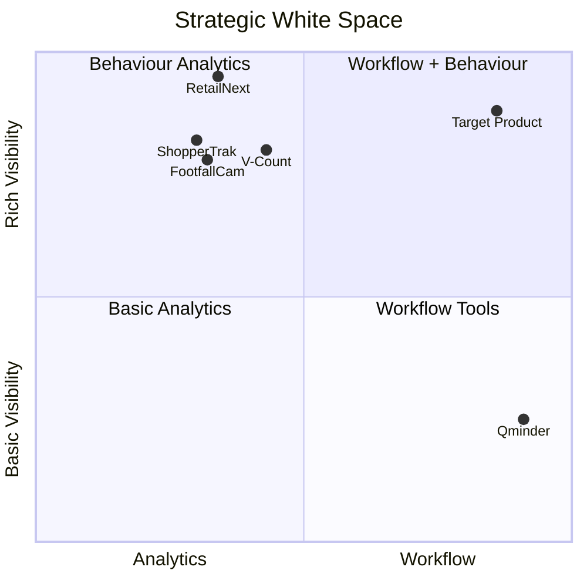
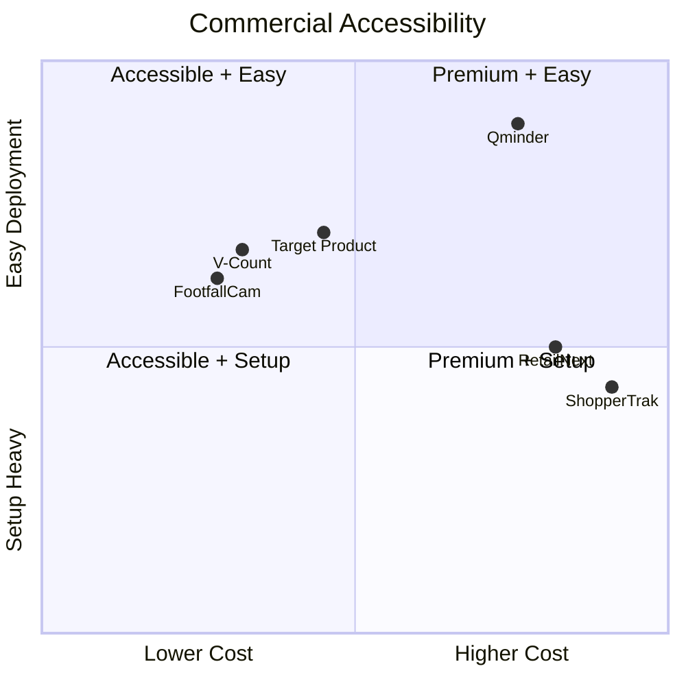
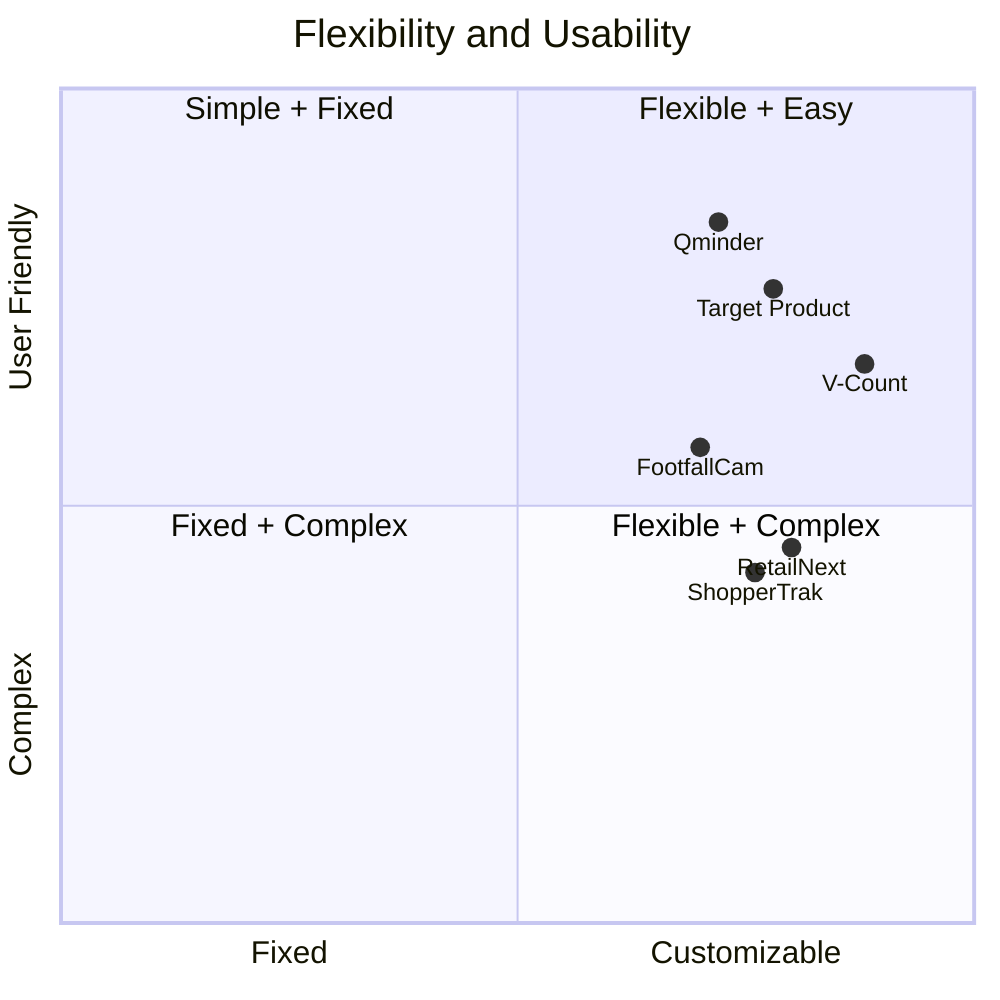
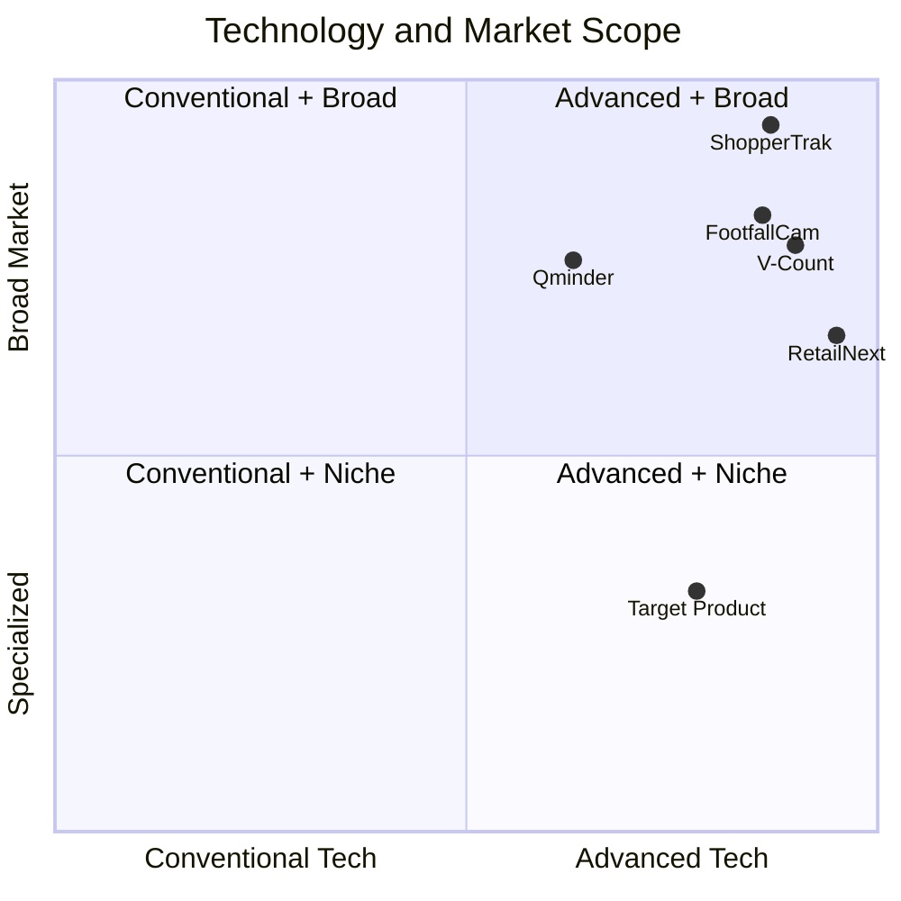

# PROBLEM / SOLUTION
In assisted-sales retail, customer visits are still often tracked manually.

## PROBLEM
* Visitor tracking depends heavily on manual staff input
* Daily operations generate limited and inconsistent visitor data
* In-store customer behaviour is largely invisible

## SOLUTION
* Digitize visitor tracking and associate workflows
* Automate visitor data collection using computer vision
* Track anonymous visitor journeys inside stores

## EXISTING ALTERNATIVES
* Staff manually track visitors and manage assignments
* CRM systems track known customers and sales
* Cameras and traffic counters provide basic analytics

# COMPETITIVE ANALYSIS
Competitive Analysis: Retail Visitor Tracking, Associate Operations & In-Store Behaviour Analytics

**Research date:** October 2026  
**Target market:** Physical retail, with emphasis on assisted-sales environments such as furniture, automotive showrooms, telecom, electronics, jewelry and other specialty retail.

## 1. Executive Summary

The opportunity sits at the intersection of three existing technology categories:

1. **People counting / traffic analytics** — determining how many customers enter a store.
2. **In-store behavioural analytics** — understanding where customers move, stop, wait and engage.
3. **Visitor / service workflow management** — managing arrivals, queues, associate assignments and service activity.

The global in-store analytics category is growing rapidly, although research firms define the market differently. Current estimates put the 2026 global market at roughly **US$5.2–6.4 billion**, with forecast compound annual growth rates of approximately **13–20%+**. North America remains the largest regional market in several estimates.

The five most relevant competitors are:

| Competitor | Classification | Competitive position | Main competitive threat |
|---|---|---|---|
| **RetailNext** | Direct | Premium/global retail analytics specialist | Very strong shopper-journey and behavioural analytics |
| **Sensormatic ShopperTrak** | Direct | Large global incumbent | Installed enterprise base, benchmarking and ecosystem |
| **FootfallCam** | Direct | Cost-focused/global specialist | Broad functionality and relatively accessible deployment |
| **V-Count** | Direct | Mid-market/global challenger | Transparent pricing, modular analytics, strong reseller model |
| **Qminder** | Indirect | Service/queue workflow specialist | Strongest alternative for replacing manual front-desk and visitor workflows |

The central competitive finding is that **the market is crowded in visitor counting and analytics, but much less crowded at the intersection of automated visitor sensing and day-to-day associate workflow**.

RetailNext, V-Count, FootfallCam and ShopperTrak can answer questions such as “How many visitors came?”, “Where did they go?”, “How long did they stay?” and “Did traffic convert into sales?” Qminder can answer “Who is waiting?”, “Who served them?”, “How long did service take?” and “How is the team performing?”

Among the five reviewed platforms, there is no obvious product positioned primarily around the complete assisted-sales operational chain:

**anonymous visitor arrives → visit/group automatically recorded → associate selected/assigned → associate accepts/declines → interaction occurs → outcome recorded → behavioural/traffic data tied to store operations.**

Within this reviewed competitor set, that gap is the clearest differentiation opportunity. It should be treated as a hypothesis to validate against additional adjacent vendors and customer interviews.

---

## 2. Market Landscape

Retail analytics is moving beyond simple door counters. Retailers increasingly combine edge cameras, 3D sensors, POS data and cloud analytics to measure conversion, occupancy, queues, dwell and merchandising performance. Grand View Research identified shopper traffic analysis as the largest in-store analytics solution category in its market work, while newer 2026 studies continue to forecast strong growth driven by edge AI, cameras and real-time retail intelligence.

The competitive landscape can therefore be represented as follows:

| Category | What it solves | Typical weakness |
|---|---|---|
| Door counters / people counting | Visitor volumes, peaks, occupancy | Limited knowledge of what happens after entry |
| Advanced retail analytics | Paths, dwell, zones, conversion, merchandising | Often enterprise-oriented; operational workflow is secondary |
| Queue / visitor management | Check-in, queue, service allocation, staff performance | Customer must usually check in; physical behaviour remains invisible |
| POS / CRM | Transactions and known customers | Cannot see anonymous non-buyers |
| CCTV | Visual evidence | Normally generates little structured operational data without analytics |
| Manual paper / spreadsheets | Flexible visitor and associate tracking | Labour-intensive, inconsistent and difficult to analyse |

This means the proposed product should **not compete as another generic people counter**. The strategically stronger position is to connect **store operations with automatically observed visitor activity**.

---

## 3. Competitor Comparison

### Analyst scoring

Scores below are my assessment of product fit for the target problem rather than vendor-supplied rankings.

| Capability | RetailNext | ShopperTrak | FootfallCam | V-Count | Qminder |
|---|---:|---:|---:|---:|---:|
| Automatic entrance counting | 5/5 | 5/5 | 5/5 | 5/5 | 1/5 |
| Anonymous in-store behaviour | 5/5 | 4/5 | 4/5 | 4/5 | 1/5 |
| Heatmaps / dwell / zones | 5/5 | 4/5 | 4/5 | 4/5 | 1/5 |
| POS/conversion analytics | 5/5 | 5/5 | 4/5 | 5/5 | 2/5 |
| Staff-related analytics | 4/5 | 3/5 | 3/5 | 3/5 | 5/5 |
| Visitor/service workflow | 2/5 | 2/5 | 2/5 | 2/5 | 5/5 |
| SMB accessibility | 2/5 | 2/5 | 4/5 | 4/5 | 3/5 |
| Pricing transparency | 2/5 | 1/5 | 4/5 | 5/5 | 5/5 |

Within this five-company comparison, the clearest white space is the **upper-right combination of behavioural intelligence and operational workflow**.

---

## 4. Competitor Profiles

### 4.1 RetailNext — Direct Competitor

#### Position

RetailNext is probably the strongest **product-level direct competitor** to an advanced version of the proposed solution. Founded in 2007, it reports more than **600 retail customers in 100+ countries** and approximately 240 employees. RetailNext describes itself as a dedicated physical-retail analytics company, and it received a majority growth investment from Battery Ventures in 2025.

#### Product

RetailNext combines traffic analytics, shopper insights and asset protection. Its Insights product includes heatmaps, dwell analysis, full-path analytics and shopper-journey visualization. It can distinguish staff from shoppers and correlate shopper behaviour with POS and other retail systems.

This is the closest competitor to the proposed future capability of tracking anonymous journeys around a store.

#### Pricing

RetailNext uses a subscription model. Its website now provides an online estimator based on number of stores, entrances, geography and other deployment variables, but it does **not publish fixed dollar prices**. Hardware support, automatic updates and sensor warranty are bundled into the subscription positioning.

#### Distribution and acquisition

RetailNext combines direct enterprise selling with a substantial partner ecosystem covering technology partners, consultants, resellers and installation providers. Its acquisition model is strongly demo/discovery-led, supported by customer case studies, retail thought leadership and partner co-selling.

#### Customer profile

The platform targets multi-location and enterprise retailers. Typical users include retail operations, merchandising, store design, marketing, analytics and loss-prevention teams. Major customer references include Macy's, Calvin Klein and other global retailers.

#### USP

Its major advantage is **depth of shopper analytics**. RetailNext can move well beyond “visitor count” into full-path analysis and store-design experimentation.

#### Weakness

The platform is relatively sophisticated and appears optimized for serious retail analytics programs rather than a lightweight SMB visitor-management process. Public G2 feedback is sparse—only three reviews—but one enterprise reviewer specifically described the solution as very expensive, while another mentioned dashboard recalculation delays. The tiny review sample means this should be treated directionally rather than statistically.

**Competitive implication:** do not try to beat RetailNext at enterprise-scale behavioural analytics initially. Compete by making the data operational at the store level.

---

### 4.2 Sensormatic ShopperTrak — Direct Competitor

#### Position

ShopperTrak is part of Sensormatic Solutions, giving it an exceptionally strong enterprise footprint. Sensormatic reports partnerships with **2,000+ retailers, approximately 185,000 store locations and more than 80 countries**, and says 70% of the global top 100 retailers use Sensormatic products or services.

This does not mean ShopperTrak itself owns that entire footprint, but it demonstrates the distribution power behind the product.

#### Product

ShopperTrak Analytics combines overhead people-counting devices with traffic, occupancy, employee-exclusion, sales and labour data. It supports customized KPIs and market benchmarking. Sensormatic advertises people counting accuracy of up to 98%.

Its Traffic Insights operation has an especially strong data advantage: Sensormatic states that its systems gather insights from around **40 billion shopper visits annually**, while its traffic benchmarking datasets cover enormous historical volumes.

#### Pricing

Pricing is enterprise and quote-based. Public fixed pricing is not available.

#### Distribution and acquisition

Sensormatic benefits from direct regional sales and support infrastructure across major markets as well as technology alliances. It is particularly strong where a retailer already purchases loss-prevention, RFID, inventory or other Sensormatic solutions.

#### Customer profile

Its natural customer is the medium-to-large retailer or shopping-centre operator needing consistent multi-location data. Case studies show deployments across international retail chains, and ShopperTrak data is used for operations, labour planning, marketing and real-estate decisions.

#### USP

Its key advantages are **scale, benchmarking data, global service infrastructure and ecosystem integration**.

#### Weakness

The same scale creates an opening below the enterprise tier. Pricing is opaque and procurement is likely to involve enterprise sales and implementation. The core product is also more naturally positioned around traffic and enterprise analytics than around a simple associate-facing visitor assignment workflow.

**Competitive implication:** Sensormatic is difficult to attack head-on in large chains, but significantly less threatening as a first competitor in small and medium assisted-sales retailers.

---

### 4.3 FootfallCam — Direct Competitor

#### Position

FootfallCam has operated since 2002 and says it has more than **500 global clients**, tens of thousands of counters installed and a partner presence in more than 100 countries. Its customers range from independent retailers to global chains and public venues.

#### Product

FootfallCam offers entrance counting, staff exclusion, group counting, live occupancy, queue analytics, demographic analysis and in-store heatmapping. Its platform can generate visitor-flow maps and integrate with POS and BI systems.

This breadth makes FootfallCam particularly important because it pushes many enterprise-style analytics capabilities down toward a more price-sensitive market.

#### Pricing

FootfallCam publishes starting retail packages around **US$550 for single-entrance counting** and approximately **US$1,100 for multiple/wide-entrance configurations**, although final deployment costs depend on configuration.

Its current software structure includes a basic V9 Lite level and a more advanced Enterprise tier, with purchasers receiving Enterprise access initially and retaining basic functionality if they do not continue the advanced subscription.

#### Distribution and acquisition

FootfallCam sells both directly and through a large international reseller/install partner network. It also maintains regional inventory and sales support in markets including the United States.

Its marketing strongly emphasizes technical documentation, cost effectiveness, product breadth and practical deployment.

#### Customer profile

Compared with RetailNext and Sensormatic, FootfallCam addresses a wider range of customer sizes and environments. Retail is central, but the same technology is marketed to offices, transportation, museums, airports and other physical venues.

#### USP

The USP is **feature breadth at a comparatively accessible entry cost**, combined with full ownership of hardware and software development.

#### Weakness

Advanced behavioural analytics can require additional camera coverage and configuration. FootfallCam's own documentation explains that in-store heatmapping may require additional cameras beyond entrance counting.

Public user-review evidence is limited. One 2026 SourceForge review reported serious accuracy and support problems, but it is a single review and should not be generalized across the customer base.

**Competitive implication:** FootfallCam is one of the more dangerous price competitors if the proposed product is sold merely as “AI people counting.”

---

### 4.4 V-Count — Direct Competitor

#### Position

V-Count reports **600+ clients across 130+ countries** and positions itself directly around visitor counting and retail analytics.

Its combination of relatively clear pricing, modern sensor hardware and reseller distribution makes it particularly relevant to a startup targeting small-to-mid-sized retail.

#### Product

V-Count combines Nano AI/Nano Prime sensors with its BoostBI platform. Capabilities include entrance counting, staff exclusion, demographics, queue measurement, heatmaps, dwell and zone analytics, POS-based conversion and an AI Sales Coach for store managers.

#### Pricing

V-Count is the most transparent direct competitor in this sample. Its published 2026 pricing is approximately:

**Hardware:** US$299–799 per sensor  
**BoostBI:** US$9–49 per sensor/month

depending on sensor type, analytics package and deployment volume.

#### Distribution and acquisition

V-Count has a reseller-driven international model. Its reseller program explicitly offers recurring licence revenue and even country-level exclusivity in selected markets, while V-Count supplies training, marketing support and regional leads.

#### Customer profile

The company serves retail stores, shopping malls, supermarkets, telecom stores, airports, libraries and **car showrooms**, among other environments.

#### USP

Its strongest differentiation is **modularity plus price transparency**. Buyers can begin with entrance counting and add POS, staff exclusion, heatmaps, demographics or queue analytics later.

#### Weakness

The modular structure also means richer analytics can require more hardware, licences and configuration. BoostBI normally updates many reports at roughly ten-minute intervals unless faster real-time updating is configured.

Public Trustpilot data is largely positive but modest in volume: 29 reviews were visible in the current dataset. A 2024 reviewer complained about technical/support problems, illustrating that field support remains an important buying consideration even when hardware functionality is good.

**Competitive implication:** V-Count is likely the closest benchmark for hardware/software economics and therefore should be watched carefully during MVP pricing.

---

### 4.5 Qminder — Indirect Competitor

#### Position

Qminder is not primarily a computer-vision company. It is a visitor, queue and in-person service-management platform.

That makes it the most strategically relevant **indirect competitor** because it attacks the manual operational side of the problem.

Qminder operates internationally and references major customers including AT&T, Verizon and Uber. Its current product pages state that it has powered more than one billion in-person service interactions.

#### Product

Customers can check in through kiosks or remotely. Employees then manage customers through a service dashboard with queues, appointments, messaging, service lines and visitor information. Management analytics include visitor volume, wait time, service time and staff performance.

This solves a significant part of the target problem without using computer vision.

#### Pricing

Current published pricing starts around:

**Business:** US$869/month  
**Premium:** US$1,149/month  
**Enterprise:** custom pricing.

#### Distribution and acquisition

Qminder is essentially SaaS-first rather than installation-first. It emphasizes rapid deployment, no installation fees, online content, demonstrations and vertical-specific case studies. Retail references include telecom, Apple resellers and other assisted-service environments.

#### Customer profile

Users are frontline employees, location managers and operations teams across retail, government, healthcare, banking and education.

#### USP

Its strongest advantage is **workflow**. Qminder captures who arrived, why they came, who served them and service-performance metrics without installing a sensor network.

#### Weakness

Its weakness is exactly the inverse of RetailNext's strength: Qminder knows about customers who enter its workflow, but it cannot independently observe the entire anonymous customer population moving around the store.

Recent verified reviews praise its ease of replacing paper processes and managing arrivals, but users also mention notification lag, filtering limitations, occasional glitches and limited data-extraction flexibility.

**Competitive implication:** Qminder strongly validates the value of digitizing visitor and staff workflows. The differentiation opportunity is to deliver that operational visibility **without requiring every visitor to manually check in**.

---

## 5. Customer Feedback and Market Signals

Public discussions reveal a recurring problem that is easy to underestimate: **retailers do not automatically trust traffic analytics simply because a sensor generates a number**.

Retail employees discussing people counters on Reddit describe experiences with inaccurate counting, employees or children distorting conversion metrics, and traffic KPIs being used in ways that staff considered unfair. Other practitioners specifically point out that lighting, camera position, staff traffic, group behaviour and environmental changes can degrade otherwise simple-looking people-counting systems. These comments are anecdotal rather than representative market research, but they reveal important adoption risks.

The implication is significant: **accuracy auditing and explainability are product features, not just engineering concerns.**

For an operational product, managers should be able to see why a visit was counted, correct obvious mistakes, configure staff/group exclusions and understand the confidence or assumptions behind metrics.

Employee adoption is equally important. If staff believe the system exists primarily to monitor or penalize them, adoption may collapse even when the technology performs correctly.

---

## 6. Differentiation Opportunity

The competitive gap can be expressed simply:

**Retail analytics vendors:**  
“We automatically measure what customers do.”

**Queue/workflow vendors:**  
“We digitally manage the customer-service process.”

**Proposed positioning:**  
“We automatically detect customer visits and connect them to the way your sales floor actually operates.”

That positioning is materially stronger than:

> “AI visitor counting.”

Counting is already commoditizing.

The more defensible data asset is the relationship between:

**traffic → visitor/group → wait → associate assignment → interaction → behaviour → outcome.**

Over time, this creates operational data that neither conventional people counters nor conventional CRMs naturally possess.

---

## 7. Strategic Recommendations

1. **Enter through assisted-sales retail rather than generic retail analytics.** Prioritize environments where each visitor matters and customer-to-associate interaction drives conversion: furniture, auto dealerships, telecom, jewelry, premium electronics and similar specialty retail.

2. **Make workflow the initial wedge.** The first commercially useful version should digitize visitor arrival, associate availability/rotation, assignment, accept/decline, service state and end-of-day reporting. Computer vision should reduce input rather than become the entire product proposition.

3. **Automate the simplest reliable CV events first.** Entrance/exit counting, group size and temporary anonymous visit IDs are more important initially than sophisticated demographic inference. Advanced paths, zone dwell and heatmaps can follow after basic data quality is proven.

4. **Do not try to replicate RetailNext in the MVP.** RetailNext has nearly two decades of experience in full-path analytics. Competing immediately on sophisticated behavioural analytics would require substantial computer-vision and deployment complexity.

5. **Integrate operational and sensor data at the event level.** A useful internal data model should eventually support events such as `VisitorEntered`, `GroupCreated`, `AssociateAssigned`, `AssignmentAccepted`, `InteractionStarted`, `InteractionEnded`, `VisitorExited` and `OutcomeRecorded`. That structure becomes the basis for analytics later.

6. **Build privacy into the positioning.** Anonymous temporary IDs, edge processing where practical, no facial identification, explicit retention controls and separation between behavioural data and PII can become commercial advantages rather than merely compliance requirements.

7. **Make accuracy visible.** Include calibration workflows, manual corrections, sensor health, staff exclusion and audit samples. A trustworthy 95–98% system with visible controls may be commercially stronger than a black box claiming 99%+.

8. **Position against manual operations rather than against enterprise analytics vendors.** The first sales story should be: “replace paper tracking and reduce missed store visits,” not “replace RetailNext.”

9. **Use a low-risk pilot GTM.** Sell initially through founder-led pilots to individual retailers or small chains, establish a baseline for missed visitor records, waiting/assignment activity and traffic completeness, then measure improvement over several weeks.

10. **Treat pricing as a validation question.** V-Count establishes a low-cost analytics benchmark at hundreds of dollars in hardware plus tens of dollars per sensor per month, while a workflow-heavy product such as Qminder starts around US$869/month. This leaves room for a combined solution, but willingness to pay should be tested directly rather than inferred from competitor prices.

---

## 8. Recommended Market Position

A useful working category would be:

**Retail Visitor Operations Platform**

rather than:

**People Counter**

or:

**Computer Vision Analytics Platform.**

A concise positioning statement could be:

**A visitor operations platform for assisted-sales retailers that automatically captures store traffic, coordinates associate interactions and turns anonymous customer activity into operational insight.**

This positioning avoids competing purely on camera accuracy and emphasizes the connection between measurement and daily operations.

---

## 9. Research Methodology and Limitations

This analysis used **secondary research and public voice-of-customer research**.

Sources included vendor websites and product documentation, current pricing pages, customer case studies, 2026 market research previews, G2, Capterra, Trustpilot, SourceForge, Reddit discussions and publicly accessible competitive-intelligence information. Market-size estimates were triangulated across multiple research providers rather than treating any single proprietary report as ground truth.

No original interviews or surveys were conducted for this report. The conclusions should therefore be treated as secondary-research hypotheses until validated with prospective customers.

The highest-priority next research phase should be approximately **10–15 structured interviews with store managers, sales leaders, reception/front-desk employees and regional operations managers in assisted-sales retail**. The interviews should validate four assumptions: how visitor/rotation tracking works today, how often records are missed, which decisions managers would actually make from better data, and what level of installation complexity/privacy concern would prevent purchase.

Similarly, conventional consumer demographic fields such as user age and personal income are not particularly meaningful for this B2B purchase. More useful segmentation variables are number of stores, visitor volume, average transaction value, degree of assisted selling, current visitor-recording method, existing POS/CRM stack and buyer role.

---

## 10. Final Assessment

### Highest competitive threat: **RetailNext**

It defines what sophisticated in-store behavioural intelligence can become.

### Strongest incumbent: **Sensormatic ShopperTrak**

Its distribution, enterprise customer relationships and benchmark datasets are extremely difficult for a startup to replicate.

### Strongest cost competitors: **V-Count and FootfallCam**

Both make automated visitor analytics accessible well below traditional enterprise deployments.

### Most important indirect competitor: **Qminder**

It demonstrates that organizations will pay specifically to replace chaotic manual visitor/service workflows.

### Best opportunity for differentiation

Do not sell merely **visitor analytics**.

Build the link between:

**visitor measurement + store workflow + associate interaction + business outcome.**

That is the portion of the reviewed competitive set where the five alternatives overlap the least.

# Perceptual Maps

The maps below compare the proposed product with RetailNext, ShopperTrak, FootfallCam, V-Count, and Qminder.

Competitor positions are relative analyst estimates based on the Competitive Analysis.  
**Target Product** represents an intended design target, not a validated current-market position. Its placement should be read as aspirational: pricing, deployment effort, usability, flexibility and technical performance still require prototype and customer validation.

---

## 1. Strategic White Space

This map shows the main competitive gap. Analytics vendors provide strong behavioural visibility, while Qminder provides strong operational workflow. The proposed product aims to combine both.

---

## 2. Commercial Accessibility

This map compares approximate cost positioning with deployment complexity. V-Count and FootfallCam are relatively accessible, while RetailNext and ShopperTrak are more enterprise-oriented. The Target Product point is an unvalidated commercial design goal rather than a demonstrated cost/deployment advantage.

---

## 3. Flexibility and Usability

This map compares product customization with usability. The Target Product point represents a design objective: a configurable product that remains simple enough for frontline retail employees. Both customization and usability still require prototype testing.

---

## 4. Technology and Market Scope

This map shows how technologically advanced each solution is relative to the breadth of its target market. The Target Product is intentionally designed to be specialized in assisted-sales retail; its technology position is a target rather than a validated competitive rating.

---

## Key Positioning

The strongest differentiation appears in **Map 1**:

**Behavioural analytics + operational workflow**

Most competitors are strong in one side of this combination, while the proposed product aims to connect:

**visitor measurement → associate workflow → interaction → behaviour → outcome**

# Customer Segmentation Report
## Retail Visitor Tracking, Associate Operations & In-Store Behaviour Analytics

**Research date:** October 2026  
**Geography:** North America, with primary emphasis on the United States and Canada  
**Target problem:** Visitor tracking depends heavily on manual staff input; daily operations generate limited and inconsistent visitor data; in-store customer behaviour is largely invisible.

The proposed solution combines three functions that are usually separated today: digitizing visitor/associate workflows, automatically collecting visitor data, and tracking anonymous customer journeys.

**Data limitation:** public market data are more complete for the United States than for Canada. Canadian evidence is included where credible data are available, so the North American ranking should be read as directional rather than as a precise TAM calculation.

## 1. Executive Summary

The strongest initial customer segments are:

| Rank | Customer profile | Market opportunity | Ease of reach | Budget | Depth of pain | Priority |
|---|---|---:|---:|---:|---:|---|
| **1** | Regional furniture & mattress showroom chains | **9/10** | **9/10** | **7/10** | **10/10** | **High — best initial beachhead** |
| **2** | Automotive dealerships & dealer groups | **8/10** | **8/10** | **10/10** | **9/10** | **High — close second** |
| **3** | Wireless / telecom authorized retail networks | **7/10** | **5/10** | **9/10** | **9/10** | **Medium-high — later entry** |

The category scores are directional analyst judgements, not measured market statistics. Furniture and automotive are close enough that the ordering should be treated as provisional until customer interviews and pilot evidence are available.

“Market share” is not directly applicable to a customer segment in the same way it is to a vendor. Public datasets also use incompatible industry definitions, so assigning a precise segment-share percentage would create false precision. This report therefore uses **addressable-market proxies** such as establishments, dealership locations and branded retail locations. The **Market Opportunity score** reflects relative addressable scale and expansion potential only; product-problem fit is assessed separately under **Depth of Pain**.

The provisional first beachhead is **regional furniture and mattress retail**. Automotive dealerships may ultimately represent greater revenue per customer, but furniture currently offers a particularly strong combination of manual sales-floor processes, large showrooms, long customer dwell times, high-value purchases and relatively accessible owner/operator decision makers. This ranking should be re-tested after customer interviews.

This follows the competitive research conclusion that the strongest white space is not another people counter. It is the combination of **anonymous visitor measurement + associate workflow + business outcome**.

---

# 2. Customer Demographics / Firmographics

For a B2B product, company characteristics are substantially more useful than the personal age or income of the buyer. Accordingly, this analysis uses **firmographics as the primary demographic layer**, while consumer age/income is provided as secondary context where credible research exists.

| Attribute | Furniture / Mattress | Automotive Dealerships | Telecom / Wireless Retail |
|---|---|---|---|
| **Best initial company size** | 3–50 showrooms | 2–30 rooftops | 10–200 stores |
| **Best buyer** | Owner, President, VP Retail Ops, Sales Director | Dealer Principal, GM, COO, VP Operations | Owner/CEO of authorized retailer, COO, Retail Ops/CX |
| **Location type** | Large suburban/urban showroom | Showroom + lot + service reception | Mall, plaza and street retail |
| **Sales model** | Highly assisted | Highly assisted | Assisted sales + service |
| **Typical visit** | Long browsing + salesperson interaction | Long research, test drive, finance/service interaction | Product/service selection, account support, upgrade |
| **Current data gap** | Anonymous browsers and salesperson rotation | Walk-ins before CRM/test-drive capture | Walk-ins, wait, browsing and service activity |
| **Initial target geography** | Major Canadian/U.S. metro areas | Major Canadian/U.S. metro areas | Authorized retailer networks in U.S./Canada |

### End-customer demographic context

**Furniture:** A 2025 U.S. furniture-shopping study reported an average respondent age of about **46 years**, with **57% having household income of $100,000+**. Houzz also found substantial large-furniture purchasing across Millennials, Gen X and Boomers, meaning the relevant showroom consumer is broad rather than confined to a narrow age group.

**Automotive:** Cox Automotive's most recent income data show that new-vehicle buyers increasingly skew affluent: in 2025, **42% of new retail vehicle sales came from households earning over $150,000**. An earlier Cox demographic profile placed the average new-vehicle buyer around age 52 and household income around $115,000, although the income distribution has moved upward since then.

**Telecom:** The consumer base is much broader. In 2026, U.S. smartphone ownership was 97% among adults 18–49, 91% among those 50–64 and 79% among those 65+. Physical stores remain especially relevant for consumers wanting assisted service; prior YouGov research found 41% of Americans preferred buying phones in-store, rising to 48% among consumers 55+.

These consumer demographics are useful for understanding store traffic, but **they should not drive B2B qualification**. Store count, traffic, average transaction value, assisted-selling intensity and current visitor-recording process are more meaningful.

---

# 3. Customer #1 — Regional Furniture & Mattress Showroom Chains

## Ideal Customer Profile

The strongest initial ICP is a **regional furniture, mattress or home-furnishing retailer operating roughly 3–50 showrooms**, rather than either a single tiny shop or a national enterprise chain.

Typical characteristics:

- large showroom where visitors browse independently before or during sales interaction;
- commission-based or rotation-based sales teams;
- high-value purchases;
- relatively low visitor volume compared with fashion/grocery, making each missed visitor commercially important;
- store managers currently using paper, spreadsheets, whiteboards or staff judgement to track visitors and sales assignments;
- multiple locations that management wants to compare consistently.

### Market Opportunity — 9/10

The U.S. Census counted **44,942 employer establishments** in furniture and home-furnishings retail in 2023. The category generated approximately **US$125.0 billion in U.S. sales in 2024**. These figures describe the broader industry location base, not the number of target 3–50-showroom companies.

The category is also highly fragmented. Of those U.S. establishments, more than 23,000 employed fewer than five people, while thousands more fell into the 5–19 employee range. That indicates a large independent/regional base, but public establishment data do not isolate how many operators specifically fall inside the 3–50-showroom ICP.

The upper end is commercially substantial as well: Furniture Today's Top 100 furniture retailers produced about **US$51.2 billion in 2025 sales**.

### Market Share / Addressable-Market Proxy

No defensible customer-segment market-share percentage is available. The best public proxy is the broader establishment/location base above, supplemented by evidence of fragmentation and regional operators.

### Ease of Reach — 9/10

This is the strongest segment for founder-led selling.

Regional owners, presidents, sales leaders and operations managers are usually identifiable, and a pilot does not necessarily require approval from a national IT organization.

A startup can approach one retailer, instrument one representative showroom and demonstrate value before requesting a chain-wide rollout.

The recommended target is therefore **not Ashley, IKEA or another huge national chain at first**. It is the regional operator large enough to feel the problem across multiple stores but small enough that one senior executive can approve an experiment.

### Budget — 7/10

Furniture retailers cannot match automotive dealership economics, but the commercial value of improving conversion on high-ticket purchases can justify meaningful operational technology spending.

The competitive landscape also provides a pricing reference. V-Count publicly prices hardware in the hundreds of dollars per sensor plus recurring analytics fees, while workflow-focused Qminder starts at hundreds of dollars per month. The source competitive analysis therefore concludes that there is room between low-cost counting and more expensive workflow software, although actual willingness to pay still needs direct validation.

The strongest business case should therefore be expressed in **missed opportunities and sales-floor productivity**, not in camera technology.

### Depth of Pain — 10/10

This segment most closely reproduces the original problem.

A shopper can enter, spend 30–60 minutes browsing, interact briefly with one or several salespeople and leave without purchasing. Unless staff record the visit correctly, the CRM/POS system may never know that customer existed.

Competitor deployments confirm demand for exactly this information. FootfallCam cites furniture and home-furnishing customers using counting, showroom occupancy and customer-flow information to understand preferences, optimize store layouts and compare promotional traffic.

This creates a particularly valuable chain:

**visitor enters → buying party identified → salesperson assigned → interaction → browsing/dwell → sale or no-sale**

That is almost exactly the market gap identified in the competitive analysis.

## Buying Trigger

The best trigger is a retailer already asking questions such as:

- “Why is Store A converting better than Store B?”
- “Are salespeople recording every UP?”
- “How many customers leave without being approached?”
- “Was Saturday slow because traffic was down or because conversion was down?”
- “Is our salesperson rotation fair?”
- “Which showroom areas actually receive attention?”

## Recommended Initial Offer

Sell a **visitor-operations pilot**, not an AI analytics platform.

Start with:

**automatic entry/group capture + associate rotation/availability + assignment + accept/decline + outcome capture + daily dashboard.**

Behavioural paths and heatmaps can be introduced later.

---

# 4. Customer #2 — Automotive Dealerships & Dealer Groups

## Ideal Customer Profile

The preferred ICP is a **privately owned dealer group with roughly 2–30 franchised dealerships**, especially groups where several salespeople share showroom traffic and management already compares performance across rooftops.

An individual dealership can work as a pilot, but the economic buyer should ideally control several locations.

### Market Opportunity — 8/10

The U.S. had **16,991 franchised light-vehicle dealerships in mid-2026**. Canada reported **3,778 franchised new light-vehicle dealerships in 2025**, giving roughly **20,800 franchised/new-car dealership locations** across the two countries before independent used-car dealerships are considered. This is a location count, not a count of dealer-group accounts.

The addressable location universe is smaller than the broader furniture/home-furnishings establishment base, but the economic value of each dealer-group account can be substantially greater. Public data do not directly isolate the number of privately owned 2–30-rooftop groups.

### Market Share / Addressable-Market Proxy

No defensible customer-segment market-share percentage is available. Dealership-location counts provide the best public scale proxy, while the actual ICP is dealer groups rather than individual rooftops.

### Ease of Reach — 8/10

Dealership ownership and management are unusually visible. Dealer principals, GMs and group executives can typically be identified directly, and strong trade organizations such as NADA and CADA provide concentrated industry access.

The challenge is not finding buyers; it is the crowded automotive technology environment. Dealers already operate CRM, DMS, digital lead management, service and OEM systems.

The sales argument therefore cannot be “another CRM.”

It should be:

**“Your CRM knows the leads you captured. We help show you the showroom traffic you didn't.”**

### Budget — 10/10

Automotive is the strongest segment financially.

NADA reports that the average U.S. franchised dealership generated approximately **US$76.6 million in annual sales in 2025**, while total dealership sales exceeded US$1.3 trillion.

Revenue does not equal software budget, but it demonstrates that a measurable improvement to showroom conversion, labour coverage or customer experience can have substantial economic value.

This makes automotive especially attractive once the product has enough evidence and integration maturity to support a higher-value enterprise sale.

### Depth of Pain — 9/10

The data gap is very clear.

V-Count's current automotive product explicitly positions entrance traffic as the top of a funnel that dealership CRMs cannot fully observe. It highlights showroom visitors, dwell by vehicle/model, visits per sales consultant, test drives and sales, noting that a person who browses and leaves may never appear in the CRM.

Dealer operations also create multiple flows:

**showroom traffic → sales consultant → test drive → finance → sale**

and separately:

**service arrival → service advisor → waiting lounge → vehicle pickup.**

A unified visitor-operations system could eventually cover both.

### Shopper Behaviour

The automotive customer journey is naturally suited to physical analytics because the visit is long, products are expensive and customers interact with multiple physical objects and employees.

The opportunity is therefore considerably deeper than counting entrances. Useful metrics eventually include:

- visitors per salesperson hour;
- visitors → test drives;
- test drives → sales;
- dwell around vehicle/model zones;
- unassisted visitor time;
- same-visit return to vehicle/model zones without cross-visit recognition;
- service reception occupancy and waiting.

## Recommended Initial Offer

Start with **one showroom entrance + sales-floor workflow**.

Do not initially attempt full outdoor-lot tracking, VIN-level interaction analytics or sophisticated DMS/CRM integration.

The first proof should answer:

**How many real buying parties entered, how quickly were they assigned, who handled them, and what happened?**

---

# 5. Customer #3 — Wireless / Telecom Authorized Retail Networks

## Ideal Customer Profile

The best initial target is **not AT&T, Verizon, Bell, Rogers or T-Mobile corporate headquarters**.

It is an **authorized retailer/franchise operator running approximately 10–200 locations** under one or several carrier brands.

This preserves the attractive telecom use case while avoiding the slowest enterprise procurement layer.

### Market Opportunity — 7/10

Telecom retail has an enormous physical footprint. Current location datasets show thousands of U.S. locations under each of the major carrier brands; for example, third-party location tracking identified roughly 5,600 T-Mobile and 5,700 AT&T branded locations in fall 2026. These are branded-location indicators rather than counts of independent authorized-retailer accounts, and exact figures vary depending on whether dealer-operated locations are included.

The reason this segment scores below furniture and automotive is **account concentration**. Thousands of physical stores may ultimately roll up into a relatively small number of carriers and large authorized retail groups.

That is excellent for rollout economics but difficult for an unknown startup entering through corporate procurement.

### Market Share / Addressable-Market Proxy

No defensible customer-segment market-share percentage is available. Branded store counts show physical scale, but they do not reveal how many locations roll up to each authorized-retailer account.

### Ease of Reach — 5/10

Independent authorized-retailer groups are reachable; the national carriers are substantially harder.

Carrier branding, required systems, store operating standards, privacy/security reviews and centralized technology decisions can all lengthen the sales cycle.

This segment therefore becomes much more attractive **after the product has reference customers**.

### Budget — 9/10

The category clearly pays for customer-flow technology.

Qminder lists AT&T and Verizon among its customers and its current platform starts at roughly US$869/month for its Business plan according to the competitive research.

That validates the commercial value of managing in-person traffic and service workflows independently from transaction systems.

### Depth of Pain — 9/10

Telecom is perhaps the strongest external validation of the **workflow** half of the proposed product.

A Qminder Verizon/Wireless Zone case describes high customer volume, visitors waiting for service and a digital queue that lets customers browse rather than stand in line. Its Sprint case describes customers leaving when stores appeared overcrowded and employees using queue management to distribute visitors through the store.

That exposes the missing layer:

Qminder can understand people who **check in**, while computer vision can observe customers who **never check in**.

A combined system could therefore identify:

**entered → waiting/browsing → assigned → served → transaction/no transaction**

without requiring every visitor to begin by touching a kiosk.

## Recommended Initial Offer

Target an authorized retailer with enough locations to care about consistency but enough autonomy to pilot technology.

Initial metrics should focus on:

- arrivals by hour;
- wait before associate engagement;
- available associates;
- queue/service assignments;
- customers leaving before service;
- visit-to-transaction conversion;
- differences between locations.

---

# 6. Why These Three Beat Other Retail Segments

The source research recommends assisted-sales environments such as furniture, automotive, telecom, electronics and jewelry because associate interaction directly affects conversion.

The three selected segments score particularly well because they share five characteristics:

1. **A visit has meaningful economic value.** Losing one customer matters much more than losing one anonymous supermarket visit.

2. **Associates matter to conversion.** This makes assignment, availability and response time commercially relevant.

3. **A transaction system sees only part of the journey.** POS and CRM data become available late in the visit or only if the customer converts.

4. **Customers spend enough time physically inside the location for behavioural data to matter.**

5. **A measurable outcome exists.** A visit can eventually be associated with a sale, test drive, service interaction, quote or other business outcome.

Fashion retail is a much larger analytics market but has weaker associate-workflow differentiation and stronger incumbent competition.

Grocery offers enormous traffic but relatively little one-to-one assisted selling.

Jewelry, optical, premium appliances and kitchen showrooms are attractive **second-wave verticals**, but their overall addressable footprint is smaller than the three selected segments.

---

# 7. Recommended Go-to-Market Sequence

### Phase 1 — Furniture / Mattress

**Objective:** Prove that automated sensing can improve an existing manual sales-floor process.

Target regional operators with **3–20 stores initially**.

Pilot one typical showroom and measure:

**manual visitor records vs. automatically detected visits → assignment time → recorded interaction → outcome.**

The most important proof point is not whether the camera achieves an impressive technical metric. It is whether management discovers commercially useful activity that their current process misses.

### Phase 2 — Automotive Dealer Groups

Once visitor capture and workflow are reliable, move into dealer groups where the economic value per site is substantially greater.

Add:

**traffic → salesperson → test drive → sale**

and eventually integrate CRM/DMS outcomes.

### Phase 3 — Telecom Authorized Retail

After establishing operational references, approach regional authorized retailers.

The product can then be positioned as a system that connects traditional queue/service management with **automatically observed store traffic**.

---

# 8. Final Customer Prioritization

## #1 Furniture & Mattress Showroom Chains — Best Beachhead

**Why:** strongest match to manual visitor/associate operations, fragmented decision-making, accessible regional owners and clear showroom analytics opportunity.

**Best ICP:** 3–50 stores.

**Primary message:**

**“Replace manual visitor tracking and capture more of what happens to showroom opportunities.”**

---

## #2 Automotive Dealer Groups — Highest Economic Upside

**Why:** enormous revenue per location, identifiable walk-in visibility gap and strong connection between physical visits, salesperson coverage and outcomes.

**Best ICP:** 2–30 rooftops.

**Primary message:**

**“Measure the showroom funnel before the CRM begins.”**

---

## #3 Telecom Authorized Retail Networks — Strongest Workflow Validation

**Why:** high customer traffic, wait/assignment problems and proven willingness to purchase queue-management technology.

**Best ICP:** 10–200 stores.

**Primary message:**

**“See and manage more of the walk-in journey, including customers who never check in.”**

---

# 9. GTM Recommendation

The company should **not initially target “retail” as one broad market**.

The recommended initial niche is:

> **Regional assisted-sales retailers where managers already attempt to track customer arrivals and associate interactions manually.**

Within that niche, furniture/mattress showrooms provide the strongest starting point.

The product should initially be sold as a **Retail Visitor Operations Platform**, not a computer-vision analytics product. That follows the core competitive finding that, among the competitors reviewed here, traditional analytics platforms are stronger at measuring customers while workflow platforms are stronger at managing service. The proposed differentiation hypothesis is the complete chain of:

**visitor measurement → group/visit → wait → associate assignment → interaction → behaviour → outcome.**

The most effective first GTM motion is therefore a low-risk, single-location pilot followed by multi-store expansion. The source competitive analysis independently reaches the same conclusion: use founder-led pilots, establish a baseline for missed visitor records and assignment activity, and measure improvement before scaling.

## Bottom Line

**Start with furniture. Design so automotive comes next. Keep telecom as the first larger-scale vertical after product-market evidence exists.**

That sequencing optimizes for learning and customer access first, while preserving substantially larger enterprise opportunities later.

# Unique Value Proposition

## Option 1 — Operations-Focused

**Turn more store visits into measurable action** by automatically capturing visitor activity, coordinating associate workflows, and connecting customer interactions to business outcomes.

## Option 2 — Visibility-Focused

**See more of the customer journey—from arrival to interaction to outcome—with less reliance on manual tracking**, giving assisted-sales retailers a clearer view of how their stores actually perform.

## Option 3 — Combined Intelligence

**Bring visitor intelligence and sales-floor operations together in one platform** that automatically captures customer activity and helps teams deliver more measurable, responsive in-store experiences.

# BASELINE QUESTIONS
## About problem (for customers)
1. Could you walk me through how visitors are currently tracked in your store?
follow-up: What challenges, if any, come up during this process?
2. Can you describe a situation when visitor data was missing, inaccurate, or inconsistent? What happened?
3. How do you currently understand what customers do after they enter the store?
Follow-up: What decisions do you make using that information?

## About solution (for Subject Matter Experts)
1. Computer Vision - How can I conduct PoC quickly? What technology and PoC scope?
2. How should I handle law and privacy concerns while using CV?
3. How C-level users are going to utilize the data that I'm going to collect?

