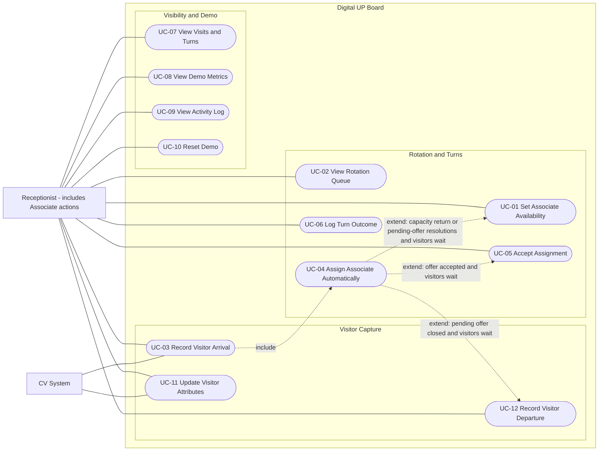
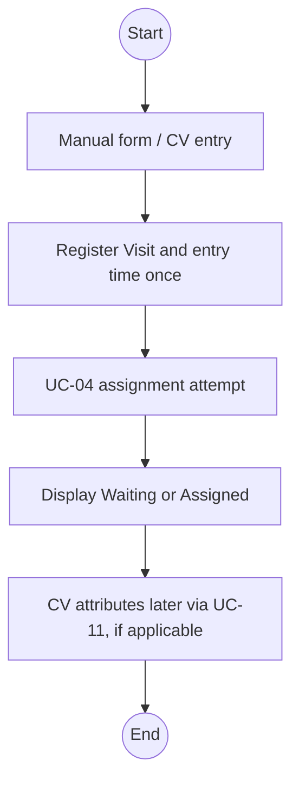
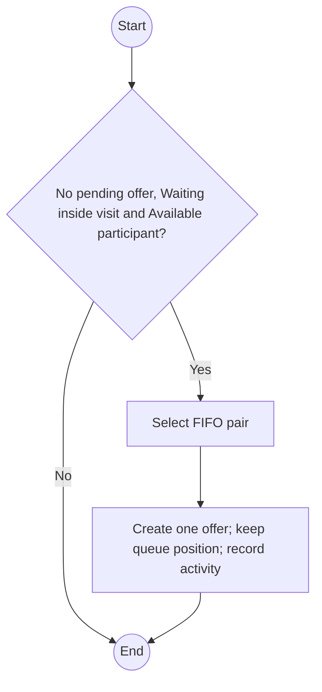
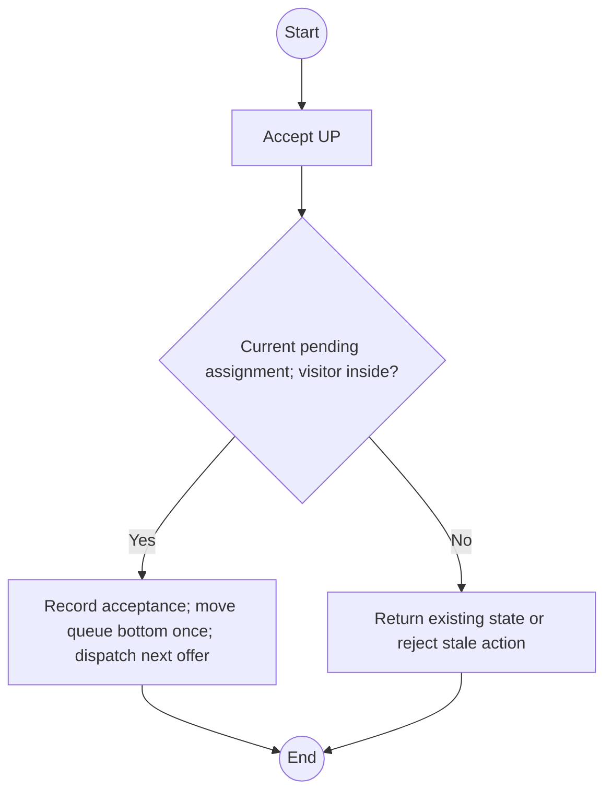
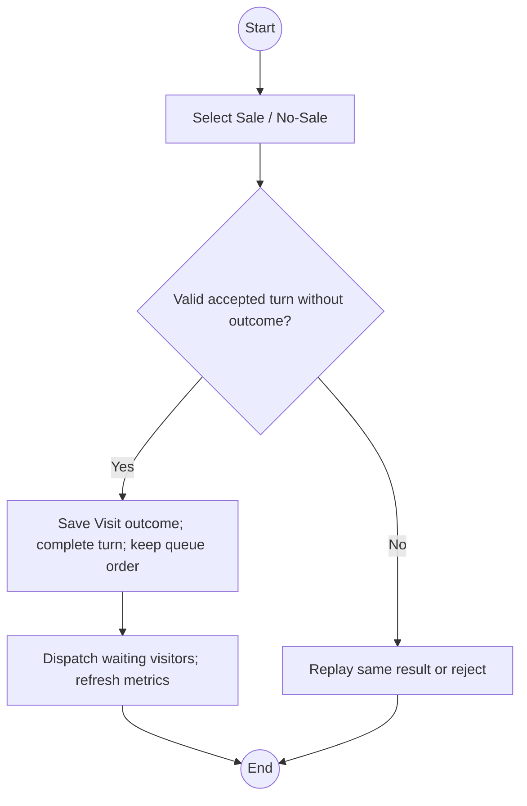
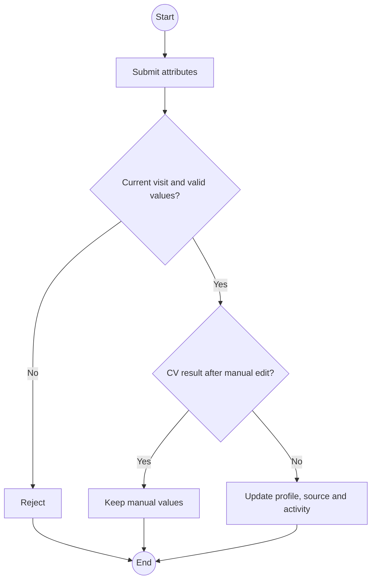
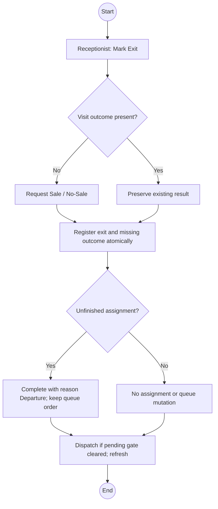

# Use Cases - 2-Day Prototype

> Breaking business-rule revision: [Advance on Acceptance](Assignment%20Rotation%20Revision.md) is authoritative for rotation, availability, pending-offer gating and DTOs. Earlier exclusive-until-outcome behavior is withdrawn. Apply this change to both independent implementation repositories.

Current revision includes visitor attributes and manual departure. [Scope Decision](Prototype%20Scope%20Decision.md) is authoritative. Receptionist performs Associate actions. SSDs remain deferred. UC-01 through UC-10 retain their IDs; UC-11/12 extend scope.

## Use-case list

| ID | Use case | Brief description | Actor / trigger | Subsystem |
|---|---|---|---|---|
| UC-01 | Set Associate Availability | Switch idle participant Available / Off Floor | Receptionist | Associate Availability |
| UC-02 | View Rotation Queue | Show eligible FIFO and all participant states | Receptionist | Rotation |
| UC-03 | Record Visitor Arrival | Create a visit manually with attributes or from CV, then attempt assignment | Receptionist / CV System | Visitor Capture |
| UC-04 | Assign Associate Automatically | Reserve first Available participant for oldest registered Waiting visit still inside | Internal condition | Rotation |
| UC-05 | Accept Assignment | Accept a pending assignment | Associate (Receptionist in PoC) | Turn Handling |
| UC-06 | Log Turn Outcome | Record purchase outcome on Visit and complete accepted Assignment | Associate (Receptionist in PoC) | Turn Handling |
| UC-07 | View Visits and Turns | Show descriptions, demographics, entry/exit, purchase result and assignments | Receptionist | Visibility |
| UC-08 | View Demo Metrics | Show visits, assigned/accepted turns, sales and conversion | Receptionist | Visibility |
| UC-09 | View Activity Log | Show operational activity | Receptionist | Visibility |
| UC-10 | Reset Demo | Clear old run; restore initial roster/order | Receptionist | Demo Session |
| UC-11 | Update Visitor Attributes | Apply CV enrichment or manual description/demographic correction | CV System / Receptionist | Visitor Capture |
| UC-12 | Record Visitor Departure | Record exit time; obtain missing purchase result; close unfinished turn if any | Receptionist | Visitor Management |

## Business rules

Create one unresolved offer at a time; advance rotation only on acceptance. FIFO visits use server registration order, not CV detection time. Acceptance moves the offered participant to queue bottom; explicit return from OffFloor also appends. Outcome/exit do not move the queue. Exclude departed visits. Purchase outcome belongs to Visit; Assignment records responsibility and service milestones only. Completed service does not imply departure. Reset clears old-run data and rejects stale commands.

Visitor fields: upper description, lower description, optional accessory, age group (<20, 20-39, 40-59, 60+ or Unknown), gender observation (Female/Male/Unknown), registered entry time, optional registered exit time, purchase outcome and its timestamp. CV demographics are estimates. Automatic attribute enrichment timing and transient-image-only handling are provisional defaults in the scope decision.

## UML use-case diagram

Mermaid flowchart approximates UML: associations are solid, include/extend are dashed. Subsystem boundaries group all use cases in one system. UC-04 is an assignment attempt, which may leave a visit Waiting. Lifecycle ordering is not an include relationship.

## Fully developed descriptions

Each description uses one table, including one row for numbered steps and one for exceptions. Activity diagrams use Mermaid flowchart notation.

### UC-03 - Record Visitor Arrival

| Field | Description |
|---|---|
| Scope / level | Digital UP Board / user goal |
| Primary actor | Receptionist / CV System |
| Stakeholders and interests | Receptionist needs reliable visits and service state; associates need fair turns; management needs consistent metrics |
| Trigger | Manual arrival form submitted or inward crossing |
| Preconditions | Current demo run exists |
| Success postconditions | One Visit created; entry registration time/order recorded; assignment attempted |
| Minimum guarantee | No partial transition, duplicate side effect, cross-run update, or invented demographic value |
| Main success scenario | 1. Actor submits arrival with event identity; manual path supplies attributes, CV may initially supply Unknown values.  2. System deduplicates and records Visit Waiting with server registered entry time, source and attributes.  3. System records activity and invokes UC-04.  4. CV analyzes its captured crop and submits UC-11 when ready; system shows current visit and enrichment state. |
| Exceptions and alternative flows | Duplicate event: return same visit without another registration.  No capacity: visit remains Waiting.  CV analysis delayed/failed: arrival and assignment proceed; unknown attributes remain visible. |
| Special requirements | Manual and CV share the same fields. Optional detectedAt is not registered entry time. Enrichment is a provisional nonblocking design; image storage remains an unresolved preference. |

#### Activity diagram

### UC-04 - Assign Associate Automatically

| Field | Description |
|---|---|
| Scope / level | Digital UP Board / supporting subfunction |
| Primary actor | None - internal behavior |
| Stakeholders and interests | Receptionist needs reliable visits and service state; associates need fair turns; management needs consistent metrics |
| Trigger | Arrival or capacity return or pending-offer resolution |
| Preconditions | Current run; attempt may find no capacity |
| Success postconditions | One PendingAcceptance assignment; Visit Assigned; participant availability and queue position unchanged |
| Minimum guarantee | No partial transition, duplicate side effect, cross-run update, or invented demographic value |
| Main success scenario | 1. Select oldest server-registered Waiting visit with no departedAt.  2. Select first Available participant by queue order.  3. Atomically create Assignment, set Visit Assigned, keep participant availability/position unchanged.  4. Append activity; stop after creating one offer. Do not bypass it before confirmation. |
| Exceptions and alternative flows | No eligible visit/capacity: finish unchanged.  Concurrent eligibility change: reevaluate without partial changes. |
| Special requirements | At most one assignment per visit and multiple accepted unfinished assignments permitted; one pending offer per session. Assignment count is derived. |

#### Activity diagram

### UC-05 - Accept Assignment

| Field | Description |
|---|---|
| Scope / level | Digital UP Board / user goal |
| Primary actor | Associate (Receptionist in PoC) |
| Stakeholders and interests | Receptionist needs reliable visits and service state; associates need fair turns; management needs consistent metrics |
| Trigger | Accept UP |
| Preconditions | Current pending assignment; visitor has not departed |
| Success postconditions | Assignment acceptedAt recorded; Visit Accepted; participant moved to queue bottom once; dispatch next oldest offer |
| Minimum guarantee | No partial transition, duplicate side effect, cross-run update, or invented demographic value |
| Main success scenario | 1. Actor selects Accept UP.  2. System validates current run, pending assignment and presence.  3. System records acceptance once, updates corresponding states and activity.  4. UI displays outcome controls. |
| Exceptions and alternative flows | Already accepted: return current phase without repeated effects.  Completed/departed/stale: do not reopen; reject or return current state. |
| Special requirements | Acceptance advances rotation and unblocks the next offer; it does not record purchase or complete service. |

#### Activity diagram

### UC-06 - Log Turn Outcome

| Field | Description |
|---|---|
| Scope / level | Digital UP Board / user goal |
| Primary actor | Associate (Receptionist in PoC) |
| Stakeholders and interests | Receptionist needs reliable visits and service state; associates need fair turns; management needs consistent metrics |
| Trigger | Sale / No-Sale selected |
| Preconditions | Accepted unfinished assignment; no visit purchase result |
| Success postconditions | Visit outcome and outcomeRecordedAt recorded; service Completed; queue position unchanged |
| Minimum guarantee | No partial transition, duplicate side effect, cross-run update, or invented demographic value |
| Main success scenario | 1. Actor selects Sale / No-Sale.  2. System validates accepted assignment and visit result.  3. System atomically records purchase result on Visit and completes Assignment with reason OutcomeRecorded.  4. System leaves availability/order unchanged, records activity and refreshes derived metrics.  5. UI refreshes; outcome does not consume or advance a rotation turn. |
| Exceptions and alternative flows | Same result replay: return existing result without any repeated queue/state effects.  Different result already stored: preserve it and reject correction.  Not accepted, departed or stale: reject without changes. |
| Special requirements | No departure time is set. Purchase result lives on Visit. Assignment completion occurs once and never rotates the queue. |

#### Activity diagram

### UC-11 - Update Visitor Attributes

| Field | Description |
|---|---|
| Scope / level | Digital UP Board / user goal |
| Primary actor | Receptionist / CV System |
| Stakeholders and interests | Receptionist needs reliable visits and service state; associates need fair turns; management needs consistent metrics |
| Trigger | Manual correction or completed image analysis |
| Preconditions | Existing current-run visit; attributes only |
| Success postconditions | Description/demographic values updated with provenance |
| Minimum guarantee | No partial transition, duplicate side effect, cross-run update, or invented demographic value |
| Main success scenario | 1. Actor submits description fields, age group and gender observation.  2. System validates values and source.  3. System applies CV values only while the profile has not been manually edited; manual corrections take precedence.  4. System records attribute-update activity and displays current fields. |
| Exceptions and alternative flows | CV result after manual correction: ignore CV write.  Analysis failure: show Failed/Unknown; do not erase useful fields.  Old-run or removed visit: reject.  Duplicate unchanged update: no additional activity. |
| Special requirements | Attribute edits cannot change entry/exit, purchase result or assignments. CV enrichment may finish after departure, but never after reset into a new visit. One profile-level manual override is sufficient for PoC. |

#### Activity diagram

### UC-12 - Record Visitor Departure

| Field | Description |
|---|---|
| Scope / level | Digital UP Board / user goal |
| Primary actor | Receptionist |
| Stakeholders and interests | Receptionist needs reliable visits and service state; associates need fair turns; management needs consistent metrics |
| Trigger | Mark Exit button |
| Preconditions | Current-run visit; normal path not yet departed |
| Success postconditions | Server exit registration time stored; Visit Completed; purchase outcome present; any unfinished turn closed |
| Minimum guarantee | No partial transition, duplicate side effect, cross-run update, or invented demographic value |
| Main success scenario | 1. Receptionist selects Mark Exit.  2. If Visit has no outcome, UI requests Sale / No-Sale; otherwise preserves existing result.  3. System atomically registers exit at server time and records missing Visit outcome.  4. System sets service Completed; if Assignment is unfinished, completes it with reason Departure without queue movement; no acceptance is invented.  5. System records departure/completion activity, updates metrics and attempts the next offer only if a pending offer was closed. |
| Exceptions and alternative flows | Waiting visitor without assignment: complete visit and store selected result; create no assignment.  Pending assignment: complete without acceptedAt; accepted count unchanged.  Already completed service: only exit time is added; participant may now serve someone else and has no queue change.  Duplicate exit: preserve original timestamp/result; conflicting result rejected.  Missing outcome selection or stale run: no mutation. |
| Special requirements | Physical presence and service status are independent. A sale without assignment still contributes to conversion. Exit timestamp is registration time, not inferred actual exit time. |

#### Activity diagram

## Deferred

Shift administration, roster check-in/out, visit removal, manual assignment, reassignment/timeouts, groups, automatic exit detection, journeys/heatmaps, accounts, POS and revenue remain deferred. Description/demographic corrections and manual departure are included.
