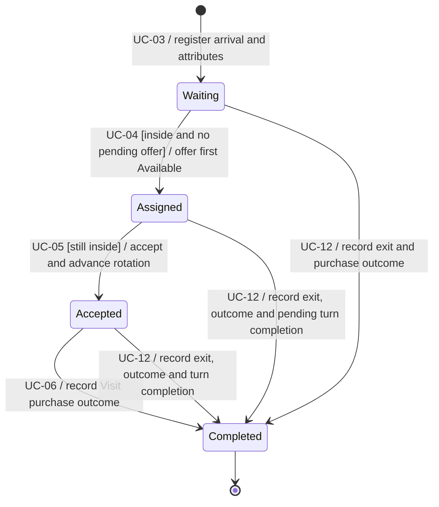
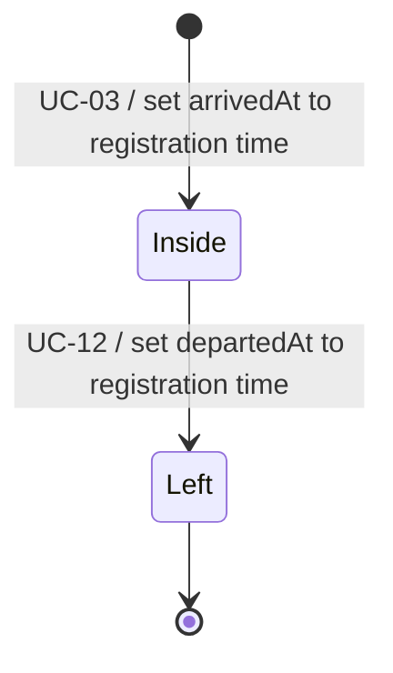

# Visit State Machine Diagram

Aligned with [Use Cases](Use%20Cases.md), [Domain Model](Domain%20Model.md) and [State Transition Consistency](State%20Transition%20Consistency.md). Service and physical presence are independent dimensions.

## Service status

## Physical presence

A Completed visit can remain Inside until Receptionist marks exit. Left always implies service Completed and purchase outcome present. Sale / NoSale is recorded once on Visit, whether or not an Assignment exists. Completed without assignment is valid after a Waiting visitor departs. Description/demographic updates do not change these states and can complete after exit. Reset deletes old-run records, not a successful departure/completion transition.
